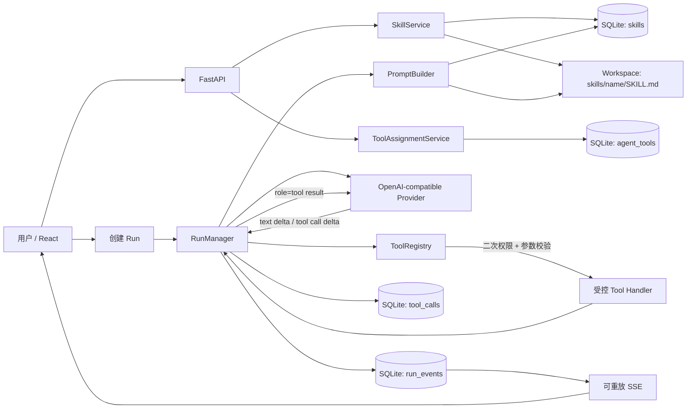
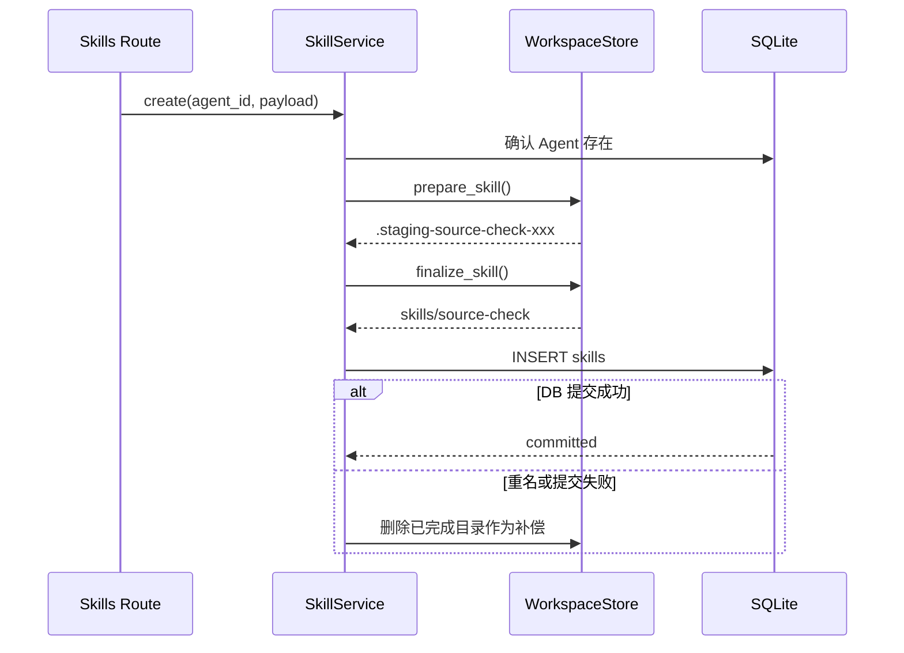

# 阶段 5：Skills、Tools 与受控 Tool Calling

> 本文既是阶段交付说明，也是你复盘代码时的阅读地图。目标不是只会点页面，而是能解释：Skill 和 Tool 为什么必须分开、一次 Tool Calling 怎样跨过前端/API/数据库/模型/执行器、以及权限为什么不能只依赖 Prompt。

## 1. 本阶段完成了什么

阶段 4 的 Agent 已经能够读取身份文件、保留多轮历史并流式回答，但它仍然只能“说”。阶段 5 给它增加两类能力：

- **Skill**：告诉 Agent 应该用什么方法工作，是可配置、可启停的 Markdown 指令；
- **Tool**：允许 Agent 对系统做什么，是服务端注册、逐 Agent 授权、参数受控的可执行函数。

本阶段的最小闭环是：

1. 用户给某个 Agent 创建并启用 Skill；
2. 用户显式给这个 Agent 打开一个 Tool；
3. Runtime 把启用的 Skill 注入系统 Prompt，只把已授权 Tool 的 JSON Schema 发给模型；
4. 模型返回原生 OpenAI-compatible `tool_calls`；
5. 服务端再次验证 Tool 名称、Agent 权限和参数；
6. Tool 在超时、路径、输出大小边界内执行；
7. 执行结果作为 `role=tool` 消息回送模型；
8. 模型结合结果生成最终自然语言回答；
9. Tool 调用全过程写入 SQLite，并通过可重放 SSE 展示。

当前版本为 `0.6.0`，数据库迁移版本为 `0006`。

## 2. 先掌握四个核心概念

### 2.1 Skill 不是可执行代码

Skill 是一段工作方法，例如：

```markdown
# 来源检查

1. 先区分事实、推断和观点。
2. 结论前检查证据是否足够。
3. 不确定时明确说明限制。
```

它会进入模型的系统 Prompt，影响模型如何思考和组织答案，但它不会自动获得文件、网络、数据库或命令行权限。

因此，Skill 的本质是：

```text
可配置策略 + Prompt 上下文 + Agent 级启停
```

### 2.2 Tool 是服务端能力

Tool 是后端代码中注册的函数。本阶段内置两个最小工具：

| Tool | 用途 | 关键边界 |
|---|---|---|
| `get_current_time` | 获取指定 IANA 时区的当前时间 | 时区由 Pydantic 校验，再由 `ZoneInfo` 解析 |
| `read_workspace_file` | 读取当前 Agent Workspace 内的 UTF-8 文本 | 只允许相对路径，禁止隐藏段、`..`、绝对路径和符号链接逃逸 |

Tool 不是让模型直接执行 Python。模型只能生成一个结构化请求，真正执行者永远是服务端的 `ToolRegistry`。

### 2.3 Tool Calling 是多步循环

阶段 4 的简化关系是：

```text
一个 Run ≈ 一次模型流式请求
```

阶段 5 变成：

```text
一个 Run = 最多 8 次模型请求 + 0 到多次 Tool 执行
```

一个典型 Run 可能包含：

```text
第 1 轮模型：请求 read_workspace_file
服务端：校验并读取文件
第 2 轮模型：根据文件内容生成最终答案
Run：completed
```

以后增加联网检索、数据库查询或 Agent 委派时，仍然复用同一个循环，而不是把每种能力硬编码进聊天接口。

### 2.4 授权必须做两遍

第一遍发生在模型请求前：只向模型声明该 Agent 已启用的 Tool。

第二遍发生在真正执行前：`ToolRegistry.execute()` 再检查 Tool 是否存在、是否属于当前 Agent 的启用集合、参数是否合法。

第二遍不能省。Prompt 和 Tool Schema 只能引导模型，不能构成安全边界。模型、上游 Provider、历史消息或未来导入的数据都有可能构造出未授权 Tool Call。

## 3. 整体架构



这里有三条相互独立但会在 Runtime 汇合的链路：

1. **Skill 配置链路**：React → Skills API → SkillService → DB + Workspace；
2. **Tool 授权链路**：React → Tools API → ToolAssignmentService → `agent_tools`；
3. **运行链路**：RunManager 读取前两条链路的最终状态，再驱动 Provider 和 ToolRegistry。

## 4. 为什么数据要这样存

### 4.1 `skills` 表

保存 Skill 的结构化元数据：

| 字段 | 含义 |
|---|---|
| `id` | Skill 的内部 UUID |
| `agent_id` | 所属 Agent；删除 Agent 时级联删除 |
| `name` | Agent 内唯一的小写标识，也是目录名 |
| `description` | 何时使用、解决什么问题 |
| `path` | 相对 Workspace 的目录，例如 `skills/source-check` |
| `enabled` | 是否注入 Runtime Prompt |
| `channel_scope_json` | 当前为 `console`，为后续 Channel 预留 |
| `config_json` | 后续扩展配置，不存可执行代码 |
| `version` | 乐观锁版本，防止两个页面相互覆盖 |

### 4.2 Skill 正文为什么不直接放数据库

正文保存到：

```text
data/workspaces/<agent-id>/skills/<skill-name>/SKILL.md
```

这样做有三个好处：

- 与 `AGENTS.md / SOUL.md / PROFILE.md / MEMORY.md` 使用同一套 Workspace 心智模型；
- 可以直接阅读、版本管理和迁移 Markdown；
- 数据库负责索引、启停、版本和关联，文件负责长文本，两者职责清晰。

代价是数据库与文件系统不共享事务，所以 `SkillService` 使用“预写临时目录 → 原子移动 → 提交数据库 → 失败补偿”的方式尽量保持一致。

### 4.3 `agent_tools` 表

它只保存某 Agent 对某个服务端 Tool 的授权状态：

```text
(agent_id, tool_name) -> enabled + config
```

没有记录就等于关闭。这个“默认拒绝”原则很重要：以后新增 Tool 时，不会自动给所有旧 Agent 获得新权限。

### 4.4 `tool_calls` 表

它记录每一次模型提出的工具调用，而不是只记录成功结果：

| 字段 | 含义 |
|---|---|
| `run_id` | 这次调用属于哪个 Run |
| `provider_call_id` | Provider 返回的 Tool Call ID |
| `tool_name` | 模型请求的名称，包括未知或越权名称 |
| `arguments_json` | 解码后的参数；非法 JSON 保存安全预览 |
| `status` | `requested/running/completed/failed/rejected` |
| `result_json` | 返回给模型的结构化结果 |
| `error_message` | 安全、可展示的错误 |
| `duration_ms` | Tool 自身执行耗时 |

`rejected` 与 `failed` 的区别：

- `rejected`：请求没有通过准入，例如未授权、未知 Tool、参数结构不合法；
- `failed`：已进入已知 Tool 的执行路径，但路径、时区、超时或运行过程失败。

无论成功、失败还是拒绝，结果都会作为 `role=tool` 消息回送模型。这样模型可以给用户一个自然语言解释，而不是让整个 Run 立即崩溃。

## 5. 代码目录与职责

```text
backend/src/pawteam_api/
├── skill_schemas.py                 Skill API 的 Pydantic 契约
├── tool_schemas.py                  Tool 授权和 ToolCall 响应契约
├── skills/service.py                DB 与 SKILL.md 的一致性协调
├── tools/registry.py                Tool 白名单、Schema、校验和执行
├── tools/service.py                 合并注册表与逐 Agent 授权
├── api/routes/skills.py             Skill CRUD / toggle API
├── api/routes/tools.py              Tool list / toggle API
├── providers/client.py              解析流式 content 与 tool_calls delta
├── runtime/prompt_builder.py        注入启用 Skill 与 Tool 名称
├── runtime/manager.py               多步模型—工具循环和审计
├── runtime/service.py               Chat 详情聚合 ToolCall
├── workspaces/store.py              Skill 文件和受限相对路径读取
└── models.py                        Skill / AgentTool / ToolCall ORM

frontend/src/
├── api/skills.ts                    Skill HTTP 客户端与类型
├── api/tools.ts                     Tool 授权 HTTP 客户端与类型
├── api/chats.ts                     ChatDetail 增加 tool_calls
├── components/AgentCapabilities.tsx Skill / Tool 可视化配置
├── pages/AgentsPage.tsx             从 Agent 卡片打开能力配置
└── pages/ChatPage.tsx               实时 Tool 事件与持久化审计
```

## 6. Skill 业务流程

### 6.1 创建

前端请求：

```http
POST /api/agents/{agent_id}/skills
Content-Type: application/json

{
  "name": "source-check",
  "description": "回答前检查来源",
  "content": "# 来源检查\n\n先检查证据，再给结论。",
  "enabled": true,
  "channel_scope": ["console"]
}
```

后端执行顺序：



创建时不用先在 PyCharm 手工建目录；`WorkspaceStore` 会创建目录、设置权限并写入 `SKILL.md`。

### 6.2 更新

更新请求必须带 `expected_version`。服务端先比较数据库当前版本，再原子替换 `SKILL.md`，最后提交元数据和新版本。如果数据库提交失败，会用旧正文补偿恢复文件。

### 6.3 启停

关闭 Skill 只修改数据库 `enabled` 和 `version`，不会删除 Markdown。下一个 Run 的 `_prepare()` 只查询启用且频道匹配的 Skill，因此无需重启服务。

### 6.4 删除

删除不是先 `rm`：

1. 将 Skill 目录原子移动为同级 `.trash-<uuid>`；
2. 删除数据库记录并提交；
3. 提交失败则把 trash 原子恢复；
4. 提交成功才清理 trash。

这就是文件系统版的补偿事务。

## 7. Tool 注册与授权流程

### 7.1 注册表是代码白名单

`ToolRegistry` 在应用启动时创建。每个 `ToolDefinition` 包含：

```text
name + description + Pydantic arguments_model + handler
```

它可以生成 OpenAI-compatible function schema：

```json
{
  "type": "function",
  "function": {
    "name": "read_workspace_file",
    "description": "...",
    "parameters": {
      "type": "object",
      "properties": { "path": { "type": "string" } },
      "required": ["path"]
    }
  }
}
```

模型看到 Schema 后知道“可以怎样请求”，但没有直接调用 Python 函数的引用。

### 7.2 前端开关只是写授权

调用：

```http
POST /api/agents/{agent_id}/tools/read_workspace_file/toggle
```

如果 `agent_tools` 中没有记录，第一次点击创建 `enabled=true`；以后点击反转状态。未知 Tool 名称直接返回 404，不能通过 API 给注册表外的字符串制造有效权限。

### 7.3 Tool 定义不会存进数据库

实现代码、参数模型和 Handler 由服务端版本控制。数据库只存授权。这能避免把“数据库里的一段字符串”误当作可执行代码，也便于代码审查和单元测试。

## 8. 一次 Tool Calling 的完整代码业务流

下面按真实调用顺序梳理。

### 步骤 1：创建 Run

React 调用：

```http
POST /api/chats/{chat_id}/runs
```

`RunCommandService.create()` 在同一事务中写入：

- 一条 `runs(status=queued)`；
- 一条 `messages(role=user)`。

API 返回 202 后，`RunManager.start(run.id)` 创建后台 asyncio Task。

### 步骤 2：准备运行上下文

`RunManager._prepare()` 查询并验证：

- Run、Chat、Agent；
- Provider、Model 和解密后的 API Key；
- 会话历史；
- `skills.enabled=true` 且包含当前 Channel 的 Skill；
- `agent_tools.enabled=true` 且仍存在于注册表的 Tool。

然后 `PromptBuilder` 组合：

```text
平台安全规则
+ Agent 身份
+ 四个核心 Workspace 文件
+ 所有已启用 Skill 正文
+ 当前 Channel、Session、Workspace、已授权 Tool 名称
+ 有界历史消息
```

注意：PromptBuilder 只负责文本上下文；真正的 function schema 由 `ToolRegistry.openai_definitions()` 生成。

### 步骤 3：调用 Provider

`OpenAICompatibleClient.stream_turn()` 请求 `/chat/completions`：

```json
{
  "model": "...",
  "messages": ["..."],
  "tools": ["仅已授权定义"],
  "tool_choice": "auto",
  "stream": true
}
```

流式响应可能交错出现两种 delta：

- `text_delta`：普通自然语言片段；
- `tool_call_delta`：Tool Call 的 `id/name/arguments` 片段。

Tool 的名称和 JSON 参数可能被拆成多个 SSE chunk，所以 Provider Client 先标准化事件，RunManager 再按 `index` 拼接，不能假定一帧就是完整调用。

### 步骤 4：记录请求和开始状态

RunManager 拼出完整调用后：

1. 插入 `tool_calls(status=requested)`；
2. 插入 `run_events(event_type=tool.requested)`；
3. 更新为 `running` 并记录 `started_at`；
4. 插入 `tool.started`。

这些事件与阶段 4 的 `run.delta` 一样存数据库，因此刷新、断线重连或 Run 结束后仍能重放。

### 步骤 5：服务端二次校验并执行

`ToolRegistry.execute()` 的准入顺序是：

```text
Tool 名称是否在注册表
  ↓
Tool 名称是否在本次 Run 的 Agent 授权快照
  ↓
arguments 是否为 JSON object
  ↓
Pydantic 是否校验通过（extra=forbid）
  ↓
在 Tool timeout 内执行 Handler
  ↓
序列化并限制结果大小
```

这样即使模型请求：

```json
{"name": "read_workspace_file", "arguments": {"path": "../../.env"}}
```

也无法读到 Workspace 外部内容。

### 步骤 6：结果写审计并回送模型

成功结果示例：

```json
{
  "ok": true,
  "data": {
    "path": "PROFILE.md",
    "content": "..."
  }
}
```

拒绝结果示例：

```json
{
  "ok": false,
  "status": "rejected",
  "error": "Tool \"read_workspace_file\" is not enabled for this Agent"
}
```

RunManager 更新 `tool_calls`，写入 `tool.completed/tool.failed/tool.rejected`，再向对话数组追加：

```json
{
  "role": "tool",
  "tool_call_id": "call_xxx",
  "content": "{...执行结果...}"
}
```

随后进入下一轮 Provider 请求。

### 步骤 7：生成最终答复并结束 Run

当某轮只有自然语言、没有 Tool Call 时，循环结束：

- 增量已经写入 `runs.output_text` 和 `run.delta`；
- `_finish_completed()` 创建最终 Assistant Message；
- `run.completed` 写入事件表；
- Chat 详情可以同时返回 messages、runs 和 tool_calls。

如果 8 步后模型仍不断请求 Tool，Run 会失败，避免死循环和费用失控。

## 9. Workspace 文件读取为什么安全

`read_workspace_file` 不是简单执行 `workspace / user_path` 后读取。`WorkspaceStore.read_relative()` 依次执行：

1. 拒绝空路径；
2. 拒绝绝对路径；
3. 拒绝 `.`、`..` 和以 `.` 开头的隐藏路径段；
4. 使用 `resolve(strict=True)` 解析真实路径；
5. 确认解析后的真实路径仍在当前 Agent Workspace 内；
6. 确认目标是普通文件；
7. 只按 UTF-8 文本读取。

第 4、5 步能防止符号链接逃逸。例如 Workspace 内有一个 `escape.txt` 符号链接指向外部文件，`resolve()` 后会发现真实目标已越界，从而拒绝。

这里校验的是“当前 Agent 的 Workspace”，不是仅仅校验“总 workspaces 根目录”。否则 Agent A 可能通过 `../agent-b/...` 读取 Agent B。

## 10. 超时、大小和中断边界

本阶段新增配置：

| 环境变量 | 默认值 | 含义 |
|---|---:|---|
| `PAWTEAM_RUNTIME_SKILL_CHARS` | 10000 | 每个 Skill 注入 Prompt 的最大字符数 |
| `PAWTEAM_RUNTIME_MAX_STEPS` | 8 | 一个 Run 最多模型/工具循环步数 |
| `PAWTEAM_TOOL_TIMEOUT_SECONDS` | 10 | 单个 Tool 最大执行时间 |
| `PAWTEAM_TOOL_RESULT_MAX_CHARS` | 20000 | 回送模型的 Tool 结果最大字符数 |
| `PAWTEAM_TOOL_EVENT_PREVIEW_CHARS` | 1000 | SSE/非法参数审计预览上限 |

这几层限制解决不同问题：

- Skill 限制控制 Prompt 体积；
- Step 限制控制循环次数；
- Tool timeout 控制单次外部动作；
- Result 限制防止文件内容把上下文撑爆；
- Event preview 防止实时事件携带大结果。

如果 Run 在 Tool 执行中被取消或进入失败终态，仍处于 `requested/running` 的 ToolCall 会被标记为 `failed`，避免数据库留下永远“运行中”的审计记录。

## 11. 前端页面如何理解

### 11.1 Agent 能力配置

Agent 卡片新增“配置 Skills / Tools”。弹窗有两个 Tab：

- **Skills**：创建、编辑、启停和删除 `SKILL.md`；
- **Tools**：展示服务端注册表，并按 Agent 打开或关闭权限。

页面刻意把两者分开，是为了让使用者看到：“写了一段 Skill”不等于“获得了某种执行权限”。

### 11.2 Agent 控制台

运行时收到以下 SSE 事件：

```text
tool.requested
tool.started
tool.completed | tool.failed | tool.rejected
```

当前 Run 的 Tool 状态即时显示；Run 结束后，Chat Detail 返回 `tool_calls`，页面在“Tool 调用审计”区域展示持久化记录。实时显示来自 `run_events`，不是浏览器自己猜测状态。

## 12. API 清单

### Skill

```text
GET    /api/agents/{agent_id}/skills
POST   /api/agents/{agent_id}/skills
PUT    /api/agents/{agent_id}/skills/{skill_name}
POST   /api/agents/{agent_id}/skills/{skill_name}/toggle
DELETE /api/agents/{agent_id}/skills/{skill_name}
```

### Tool 授权

```text
GET  /api/agents/{agent_id}/tools
POST /api/agents/{agent_id}/tools/{tool_name}/toggle
```

### Runtime 复用阶段 4 API

```text
POST /api/chats/{chat_id}/runs
GET  /api/runs/{run_id}/events
GET  /api/chats/{chat_id}  # 现在额外包含 tool_calls
```

## 13. 你在 PyCharm 中亲手执行的步骤

以下操作由你完成，我不代替你点击 PyCharm。

### 13.1 确认分支

在 PyCharm 右下角 Git 分支区域确认当前分支：

```text
codex/stage-5-tools-skills
```

也可以在 PyCharm Terminal 只读确认：

```bash
git status --short --branch
```

### 13.2 同步依赖和迁移数据库

在项目根目录 Terminal 执行：

```bash
uv sync
cd frontend
npm install
cd ..
uv run alembic upgrade head
uv run alembic current
```

预期最后显示：

```text
0006 (head)
```

### 13.3 启动服务

用你已有的两个 PyCharm Run Configuration：

1. 启动 `Backend API`；
2. 启动 `Frontend Dev`；
3. 浏览器打开 `http://127.0.0.1:5173`。

### 13.4 手工验收 Skill

1. 打开“Blueprint 与 Agent”；
2. 找到一个 Agent，点击“配置 Skills / Tools”；
3. 新建 `source-check`；
4. 写入来源检查流程并保存；
5. 确认页面显示 `skills/source-check/SKILL.md`；
6. 关闭开关后发起一次对话，再打开后发起一次对话，对比模型行为；
7. 在 PyCharm Project 面板查看 `data/workspaces/<agent-id>/skills/source-check/SKILL.md`。

### 13.5 手工验收 Tool

1. 在 Tools Tab 打开 `get_current_time`；
2. 选择支持原生 Tool Calling 的 Model；
3. 在控制台问：“请调用工具告诉我 Asia/Shanghai 当前时间”；
4. 观察实时出现 requested → running → completed；
5. Run 结束后查看 Tool 调用审计；
6. 再打开 `read_workspace_file`，要求模型读取 `PROFILE.md` 并总结；
7. 关闭该 Tool 后再试，确认新的 Run 不再收到其 Tool Schema。

模型是否主动调用 Tool 取决于模型能力和判断。若模型只直接回答时间，不代表后端失败；应确认所选 Provider/Model 支持 OpenAI-compatible function calling。

### 13.6 自动验证

在 PyCharm Terminal 执行：

```bash
uv run ruff check backend
uv run pytest -q
cd frontend
npm run check
npm run build
cd ..
docker compose config
uv run alembic check
```

本阶段测试重点包括：

- Skill 文件落盘、乐观锁冲突和删除补偿；
- Agent Tool 默认关闭；
- 流式 Tool Call 片段拼接；
- Tool 结果回送模型后继续生成；
- 越权伪造调用被审计并拒绝；
- `../` 路径遍历和符号链接逃逸失败；
- 原有会话、取消、Provider、Blueprint 和 Workspace 测试不回归。

## 14. 推荐的代码阅读顺序

第一次复盘不要从 React 开始。按下面顺序会更容易建立心智模型：

1. `models.py`：先认识三张表；
2. `tools/registry.py`：理解什么是受控执行边界；
3. `workspaces/store.py`：理解文件隔离和原子操作；
4. `skills/service.py`：理解 DB + 文件补偿事务；
5. `runtime/prompt_builder.py`：看 Skill 怎样成为上下文；
6. `providers/client.py`：看上游流式 Tool Call 怎样被标准化；
7. `runtime/manager.py`：串起完整循环；
8. `runtime/service.py`：看查询侧如何聚合审计；
9. `AgentCapabilities.tsx` 和 `ChatPage.tsx`：最后看 UI 如何映射后端状态；
10. `test_tools_skills.py`：用测试把心智模型再验证一遍。

## 15. 你必须能够独立回答的问题

完成阶段 5 后，建议你不看文档回答以下问题：

1. Skill 和 Tool 的本质区别是什么？
2. 为什么 Tool 权限不能只写进系统 Prompt？
3. 为什么新增 Tool 后旧 Agent 默认不能使用？
4. 一个 Run 为什么可能访问 Provider 多次？
5. 流式 `tool_calls` 为什么要按 index 拼接？
6. Tool 失败为什么还要把结果回送模型？
7. `rejected` 和 `failed` 有什么区别？
8. 如何防止 Agent A 读取 Agent B 的 Workspace？
9. 为什么 Skill 的元数据在 SQLite、正文在 Markdown？
10. DB 和文件不能共用事务时，创建、更新和删除分别怎么补偿？
11. 页面刷新后为什么仍能看到 Tool 事件和结果？
12. 如何阻止模型无限调用 Tool？

如果这些问题你能用自己的话讲清楚，说明你掌握的是架构，而不是只记住文件名。

## 16. 常见问题

### 16.1 Provider 返回“不支持 tools/function calling”

说明当前模型或 OpenAI-compatible 网关没有实现原生 Tool Calling。先确认：

- Model 本身支持 function calling；
- 网关接受 `tools` 和 `tool_choice`；
- 返回的流式格式包含 `choices[0].delta.tool_calls`。

这是 Provider 能力问题，不要通过让模型输出一段“看起来像 JSON”的普通文本绕过执行边界。

### 16.2 Tool 已打开，但模型没有调用

Tool 授权表示“可以调用”，不是“强制调用”。可以把问题写得更明确，例如“请先调用 `read_workspace_file` 读取 `PROFILE.md`，再回答”。未来可以增加强制 Tool Choice 或工作流编排，但本阶段保留模型自主选择。

### 16.3 Skill 文件存在，但没有注入

检查三点：

- `skills.enabled` 是否为 true；
- `channel_scope_json` 是否包含当前 `console`；
- 数据库 `path` 是否仍对应真实 `SKILL.md`。

### 16.4 路径明明存在却读取失败

本阶段只允许相对当前 Agent Workspace 的非隐藏 UTF-8 文件。绝对路径、`..`、隐藏目录、目录本身、二进制文件和指向外部的符号链接都会失败，这是设计行为。

## 17. 本阶段刻意没有做什么

- 没有任意 Shell Tool；
- 没有让用户上传 Python 代码并执行；
- 没有联网搜索 Tool；
- 没有 Team 或 Agent-to-Agent 委派；
- 没有微信、企业微信等外部 Channel；
- 没有自动记忆写回；
- 没有复杂 RBAC 和多租户。

边界保持小而完整，能让你在简历中准确描述：你实现了一个有显式授权、Schema 校验、文件隔离、超时限制、持久化审计和可重放事件的 Tool Calling Runtime，而不是仅仅把两个函数塞进 Prompt。

## 18. Git 阶段快照

阶段 5 分支：

```text
codex/stage-5-tools-skills
```

与阶段 4 对比：

```bash
git diff codex/stage-4-runtime..codex/stage-5-tools-skills --stat
git diff codex/stage-4-runtime..codex/stage-5-tools-skills
```

阶段 6 将从这个分支继续，重点是 Team、Agent 间受控委派和协调 Agent。委派本质上也会作为一种受控能力接入，但必须增加父子 Run、调用深度、预算、环路阻断和上下文传递边界，不能简单让 Agent 相互无限调用。
