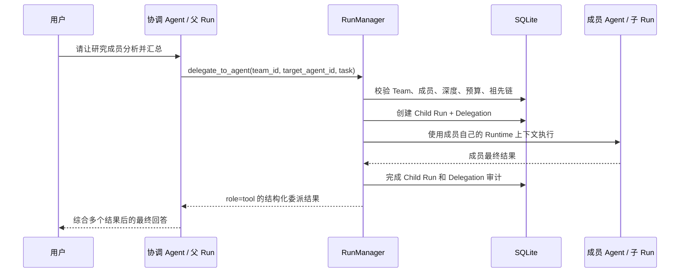

# 阶段 6：Team 与受控 Agent 委派

> 本阶段把“多个 Agent 可以交流”实现为一个可解释、可限制、可审计的父子 Run 体系。阅读重点不是页面上多了一个 Team，而是理解协调 Agent 如何获得成员白名单、子 Agent 为什么必须独立运行，以及系统如何阻止越权、环路和无限委派。

## 1. 阶段目标

阶段 5 的 Tool Calling 已经建立通用循环：模型提出结构化调用，服务端验证后执行，再把结果回送模型。阶段 6 在这个循环中加入一种特殊的内部能力：

```text
delegate_to_agent
```

协调 Agent 可以通过它把一个边界清晰的子任务交给 Team 成员。成员使用自己的：

- Provider 与 Model；
- `AGENTS.md / SOUL.md / PROFILE.md / MEMORY.md`；
- 已启用 Skills；
- 已授权 Tools；
- Team 能力（如果成员本身也是另一个 Team 的协调者）。

成员不会继承父 Agent 的 Workspace、Skill、普通 Tool 或 API 权限。父 Agent只收到子 Run 的最终结果。

当前版本为 `0.7.0`，数据库迁移版本为 `0007`。

## 2. 五个核心对象

### 2.1 Team

Team 是委派授权边界，不是聊天群，也不是共享 Prompt。

一个 Team 包含：

```text
一个 coordinator
+ 一个或多个 member
+ active / disabled 状态
+ 版本号
```

只有被标记为 `is_coordinator=true` 的活动 Agent 才能成为协调者。

### 2.2 TeamMember

`team_members` 把 Agent 和 Team 关联起来，并明确保存：

```text
coordinator 或 member
```

协调者不会同时作为普通成员重复保存。Team 更新时，成员集合整体替换并通过乐观锁防止覆盖。

### 2.3 Root Run

用户在控制台发送消息创建的 Run 是根 Run：

```text
parent_run_id = NULL
depth = 0
```

同一个 Chat 同时只能存在一个活动根 Run。

### 2.4 Child Run

每次成功准入的委派都会创建一个子 Run：

```text
parent_run_id = 发起委派的 Run ID
agent_id = 目标成员 Agent ID
depth = parent.depth + 1
```

子 Run 与父 Run 使用同一个 ChatSession 作为审计归属，但不会写入普通聊天 Message，避免把成员中间答案混进用户对话。

### 2.5 Delegation

`delegations` 表连接父子 Run，并保存：

| 字段 | 含义 |
|---|---|
| `root_run_id` | 整棵委派树的根，用于总调用预算 |
| `parent_run_id` | 谁发起了委派 |
| `child_run_id` | 哪个独立 Run 执行任务 |
| `team_id` | 使用哪个 Team 白名单 |
| `source_agent_id` | 发起 Agent |
| `target_agent_id` | 成员 Agent |
| `task` | 交付给成员的完整任务 |
| `depth` | 当前委派深度 |
| `status/result/error` | 执行结果与审计 |

## 3. 整体业务流



一次用户请求可能形成：

```text
Root Run（协调 Agent）
├── Child Run（研究 Agent）
├── Child Run（写作 Agent）
└── Child Run（审查 Agent）
```

本阶段按模型返回顺序依次执行 Tool Call，暂不并行执行多个成员。

## 4. Team 配置链路

前端“Team 与委派”页调用：

```text
GET    /api/teams
POST   /api/teams
PUT    /api/teams/{team_id}
POST   /api/teams/{team_id}/toggle
DELETE /api/teams/{team_id}
```

创建请求示例：

```json
{
  "name": "内容生产团队",
  "description": "研究、写作和审查协作",
  "coordinator_agent_id": "协调者 UUID",
  "member_agent_ids": ["研究员 UUID", "写作者 UUID"]
}
```

`TeamService` 验证：

1. 所有 Agent 均存在；
2. 协调 Agent 已标记为 coordinator；
3. 协调者和成员全部处于 active；
4. 成员不重复；
5. 协调者不出现在普通成员列表；
6. Team 名称不重复。

有委派历史的 Team 不允许物理删除，因为那会破坏审计引用；应改为 disabled。

## 5. 动态委派 Tool

`delegate_to_agent` 与阶段 5 的普通 Tool 有一点不同：它不通过 AgentTool 开关授权，而是由活动 Team 动态授权。

Runtime 准备协调 Agent 时查询：

```text
Agent.is_coordinator = true
AND Team.coordinator_agent_id = Agent.id
AND Team.status = active
AND Team 至少有一个 active member
```

满足条件才会向模型添加：

```json
{
  "name": "delegate_to_agent",
  "parameters": {
    "team_id": "必须属于当前协调者",
    "target_agent_id": "必须属于选定 Team",
    "task": "边界清晰的成员任务"
  }
}
```

Tool 描述和系统 Prompt 同时包含可用 Team、成员名称、ID 和职责。这样模型能选择成员，但真正执行前服务端仍会二次校验。

## 6. 完整运行代码流程

### 6.1 `_prepare()` 为协调者组装能力

`RunManager._prepare()` 除阶段 5 的历史、Skill 和普通 Tool 外，还调用 `_delegation_teams()`。

有可用 Team 时：

- Prompt 增加 Team 与成员职责；
- Tool 名称集合增加 `delegate_to_agent`；
- 请求 Provider 的 Tool Definitions 增加动态委派 Schema。

Team 被关闭或所有成员被停用后，下一个 Run 不再获得该 Tool。

### 6.2 模型提出委派

模型返回：

```json
{
  "name": "delegate_to_agent",
  "arguments": {
    "team_id": "...",
    "target_agent_id": "...",
    "task": "分析目标市场，只返回证据和三条结论"
  }
}
```

它仍然先进入阶段 5 已有的 ToolCall 审计，所以同一次委派会留下：

- 一条 `tool_calls`：证明模型请求了特殊 Tool；
- 一条 `delegations`：证明具体父子 Agent/Run 关系。

### 6.3 二次准入校验

`_execute_delegation()` 依次检查：

```text
arguments 是合法 JSON 且符合 Pydantic Schema
  ↓
Team 当前仍活动且属于发起协调者
  ↓
target_agent_id 是该 Team 的活动成员
  ↓
目标不在当前父 Run 的祖先 Agent 链中
  ↓
child depth 不超过配置上限
  ↓
整棵 root Run 的委派次数未耗尽
  ↓
目标 Agent 和 Model 仍然存在、Agent 仍活动
```

任何一步失败都会把 ToolCall 标记为 `rejected`，不会创建子 Run。

### 6.4 创建子 Run

通过校验后，一个事务写入：

- `runs` 中的 child Run；
- `delegations(status=running)`；
- 父 Run 的 `delegation.started` 事件。

活动根 Run 唯一索引现在只约束：

```sql
parent_run_id IS NULL
AND status IN ('queued', 'running', 'cancelling')
```

因此同一 Chat 可以有一个根 Run和它的多个子 Run，但不能有两个用户根请求并发执行。

### 6.5 子 Agent 独立准备 Prompt

子 Run 不加载协调者的聊天历史。它加载：

```text
成员自己的平台规则
+ 成员自己的 Agent 身份
+ 成员自己的四个核心 Workspace 文件
+ 成员自己的启用 Skills
+ 成员自己的 Tool 权限
+ 一条合成 User Message：委派任务
```

合成消息明确告诉成员：不要假装拥有协调者上下文或权限，只完成独立任务并返回结果。

### 6.6 结果返回父 Run

子 Run completed 后：

- 完整输出保存在 child `runs.output_text` 和 `delegations.result_text`；
- 不创建普通 Assistant Message；
- 返回父模型的结果受 `tool_result_max_chars` 限制；
- 父 Run 写入 `delegation.completed`；
- 结果作为 `role=tool` 回到协调模型；
- 协调模型继续汇总并生成面向用户的最终回答。

## 7. 安全和资源边界

### 7.1 默认无委派权限

普通 Agent、没有活动 Team 的协调 Agent、停用 Team 的协调 Agent都不会收到委派 Tool Schema。即使模型伪造 `delegate_to_agent`，服务端也会记录并拒绝。

### 7.2 成员白名单

模型不能通过提供任意 Agent UUID 绕过 Team。目标必须存在于本次 Run 准备出的具体 Team 成员集合中，执行时还会查数据库确认状态。

### 7.3 祖先环路阻断

运行链：

```text
A → B → C
```

C 不能再委派给 A 或 B，因为它们已经在祖先 Agent 集合中。这阻止直接和间接回环。

同一个成员在父 Run 的不同分支中可以被多次调用，但会受到总调用预算限制。

### 7.4 深度限制

默认：

```text
PAWTEAM_DELEGATION_MAX_DEPTH=2
```

根 Run 深度 0，第一层成员深度 1，成员若也是协调者最多再产生深度 2。继续委派会被拒绝。

### 7.5 调用预算

默认一棵根 Run 委派总数：

```text
PAWTEAM_DELEGATION_MAX_CALLS_PER_ROOT=6
```

预算以 `root_run_id` 统计，不能通过嵌套子 Run 重置。

### 7.6 任务和结果大小

```text
PAWTEAM_DELEGATION_TASK_MAX_CHARS=8000
PAWTEAM_TOOL_RESULT_MAX_CHARS=20000
```

数据库保留成员完整结果，返回父模型的内容有界，避免子 Agent 撑爆父上下文。

### 7.7 取消与超时

父 Run 被取消或超时时，取消会传播到当前等待的子 Run。子 Run 和 Delegation 进入终态，父 ToolCall 也不会永久停留在 running。

应用重启恢复时，活动 Run 会按阶段 4 规则失败或取消；未完成 Delegation 会标记为 failed。

## 8. 数据库变化

迁移 `0007`：

```text
teams
team_members
delegations
runs.parent_run_id
runs.depth
```

查看委派树：

```sql
SELECT
  d.id,
  d.parent_run_id,
  d.child_run_id,
  d.source_agent_id,
  d.target_agent_id,
  d.status,
  d.depth,
  d.duration_ms
FROM delegations d
ORDER BY d.created_at;
```

查看父子 Run：

```sql
SELECT id, agent_id, parent_run_id, depth, status, output_text
FROM runs
ORDER BY created_at;
```

## 9. 前端如何映射后端状态

“Team 与委派”页负责配置：

- 选择协调 Agent；
- 选择成员白名单；
- 启停 Team；
- 编辑成员；
- 删除没有历史的 Team。

Agent 控制台监听：

```text
delegation.started
delegation.completed
delegation.failed
```

运行中显示成员等待状态；Run 结束后由 Chat Detail 的 `delegations` 返回持久化审计。页面刷新时只重连活动根 Run，不会错误连接到成员子 Run，也不会把成员流式草稿直接展示给用户。

## 10. PyCharm 中由你亲手完成的验收

### 10.1 更新数据库

在 PyCharm Terminal 执行：

```bash
uv sync
cd frontend
npm install
cd ..
uv run alembic upgrade head
uv run alembic current
```

预期：

```text
0007 (head)
```

### 10.2 准备三个 Agent

在“Blueprint 与 Agent”页准备：

```text
内容协调者：is_coordinator = true，职责是拆分任务并汇总
行业研究员：职责是调查事实、风险和证据
内容写作者：职责是把资料写成清晰文章
```

最好给三者配置不同的 `SOUL.md / AGENTS.md`，这样更容易观察独立身份。

### 10.3 创建 Team

进入“Team 与委派”：

```text
名称：内容生产团队
协调 Agent：内容协调者
成员：行业研究员、内容写作者
```

确认 Team 状态显示“可委派”。不需要在普通 Tools Tab 打开 `delegate_to_agent`，Team 本身就是授权来源。

### 10.4 发起一次委派

在控制台选择“内容协调者”，新建会话后发送：

```text
请完成一份“中小企业为什么需要合同风险检查”的三段式短文。
先委派行业研究员给出三个有依据的需求和两个风险，
再委派内容写作者根据研究结果写初稿，最后由你汇总回答。
```

模型是否会一次调用两个成员取决于模型的 Tool Calling 能力。至少应观察到一次：

```text
delegation.started
→ 子 Run completed
→ delegation.completed
→ 协调 Agent 汇总
```

### 10.5 检查隔离

在研究员的 `PROFILE.md` 写一个独有标识，在协调者中不要写。委派研究员读取时能使用，协调者自己的 Workspace 不会自动拥有该信息。

关闭 Team 后新建 Run，协调 Agent将不再收到 `delegate_to_agent` Tool。

### 10.6 自动验证

```bash
uv run ruff check backend
uv run pytest -q
cd frontend
npm run check
npm run build
cd ..
docker compose config
uv run alembic check
```

本阶段自动测试覆盖：

- 非协调 Agent 不能创建 Team；
- Team 创建、成员角色、启停和历史删除保护；
- 动态 Tool Schema 只给有活动 Team 的协调者；
- 子 Run 使用成员身份和独立委派任务；
- 子 Run 不污染普通聊天 Message；
- Delegation、ToolCall、RunEvent 三类审计一致；
- 普通 Agent 伪造委派请求仍被拒绝；
- 阶段 0～5 的全部测试不回归。

## 11. 推荐代码阅读顺序

```text
models.py
→ migration 0007
→ team_schemas.py
→ teams/service.py
→ teams/runtime.py
→ runtime/manager.py 的 _delegation_teams
→ runtime/manager.py 的 _execute_delegation
→ runtime/service.py 的 ChatDetail 聚合
→ TeamsPage.tsx
→ ChatPage.tsx
→ test_teams.py
```

先看数据关系，再看授权，最后看递归执行；直接从最大的 RunManager 开始容易迷失。

## 12. 你必须能回答的问题

1. Team 为什么不是共享 Prompt 或共享 Workspace？
2. `is_coordinator=true` 为什么还不足以获得委派能力？
3. `delegate_to_agent` 为什么不使用普通 AgentTool 开关？
4. Root Run 和 Child Run 如何区分？
5. 为什么子 Run 不创建普通 Assistant Message？
6. 父 Agent 能否看到子 Agent 的密钥或 Workspace？
7. Team 关闭后为什么下一个 Run 自动失去委派 Tool？
8. 如何阻止 A → B → A？
9. 为什么调用预算必须按 `root_run_id` 统计？
10. 父 Run 取消时，当前子 Run 怎么处理？
11. 为什么同时保存 ToolCall 和 Delegation？
12. 有历史的 Team 为什么只能停用、不能删除？

能独立讲清这些问题，就掌握了一个小型多 Agent Runtime 的核心，而不只是“让两个模型互相发消息”。

## 13. 本阶段未实现

- 多成员并行执行；
- DAG 工作流编辑器；
- Token/费用总预算；
- 人工审批委派；
- 跨 Team 共享知识库；
- 外部微信、企业微信等 Channel；
- 分布式任务队列和多进程子 Run。

下一阶段将进入 Channel Adapter：把 Console 之外的不同终端统一转换为内部消息，并继续复用 Agent、Session、Run、Tool 和 Team Runtime。

## 14. Git 快照

```text
codex/stage-6-team
```

对比阶段 5：

```bash
git diff codex/stage-5-tools-skills..codex/stage-6-team --stat
git diff codex/stage-5-tools-skills..codex/stage-6-team
```
