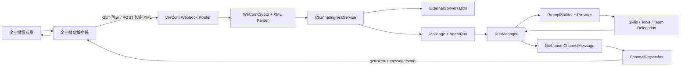

# 阶段 7：企业微信 Channel 与外部消息闭环

## 1. 本阶段完成了什么

阶段 7 第一次让 PawTeam Lite 离开自己的 Web 控制台。企业微信成员可以给自建应用发送文本消息，系统把消息交给指定 Agent；如果这个 Agent 是某个启用 Team 的协调者，它仍然可以调用阶段 6 的 `delegate_to_agent`，最后由企业微信应用主动回复成员。

本阶段不是把企业微信代码直接塞进 Agent Runtime，而是建立了两层：

- 通用 Channel 内核：Channel 配置、外部会话映射、收发消息日志、幂等和 outbound 队列；
- 企业微信 Adapter：`msg_signature` 验证、AES 解密、XML 解析、access_token 缓存和应用消息发送。

以后增加飞书或钉钉时，主要新增 Adapter；Chat、Run、Agent、Team、Skill、Tool 等核心能力继续复用。

本阶段版本为 `0.8.0`，Alembic 数据库版本为 `0008`，Git 分支为 `codex/stage-7-channels`。

## 2. 先掌握六个业务对象

### 2.1 Channel

`Channel` 表示一个外部消息入口。本阶段每个 Channel 对应一个企业微信自建应用配置，并且只绑定一个 Agent。

它回答四个问题：

1. 消息来自哪个渠道：`kind = wecom`；
2. 收到消息后交给谁：`agent_id`；
3. 渠道是否允许继续收发：`status`；
4. 非敏感配置是什么：`config_json` 中的 `corp_id` 和企业微信应用 `agent_id`。

如果绑定的是普通 Agent，它直接回答。如果绑定的是协调 Agent，原有 Team Runtime 会根据已启用的 Team 决定是否向模型提供委派 Tool。Channel 不需要理解 Team。

### 2.2 WeComSecrets

企业微信的三项敏感配置是：

- 回调 `Token`：参与回调签名；
- `EncodingAESKey`：解密回调报文；
- 自建应用 `Secret`：换取 access_token，供主动发送消息使用。

三项被序列化后写入原有 Fernet `SecretStore`。SQLite 的 `channels.secret_ref` 只保存密钥文件引用，API 响应只返回 `has_secrets`，不会回显明文。

CorpID 和 AgentId 是定位企业与应用的标识，不按密钥处理，保存在 `config_json`，便于查看和修改。

### 2.3 ExternalConversation

企业微信的 `FromUserName` 是成员 UserID。本阶段的自建应用私聊场景用它作为外部会话键：

```text
(channel_id, external_conversation_id)
                ↓ 唯一映射
          chat_session_id
```

成员第一次发消息时创建内部 `ChatSession(channel="wecom")`；以后在同一 Channel 发消息时继续使用这个 Chat，因此模型能够读取多轮历史。

不同 Channel 即使收到同一个 UserID，也会映射到不同 Chat，不会串话。

### 2.4 ChannelMessage

`ChannelMessage` 是渠道层审计记录，不替代内部 `Message`：

- `ChannelMessage` 记录企业微信边界上的接收、投递、重试和错误；
- `Message` 记录模型实际看到的 user/assistant 对话；
- `AgentRun` 记录一次模型执行；
- `RunEvent`、`ToolCall`、`Delegation` 继续记录执行细节。

一条正常企业微信问答会产生两条 ChannelMessage：

```text
inbound  企业微信成员 → PawTeam    status: processing → completed
outbound PawTeam → 企业微信成员    status: pending → delivering → delivered
```

### 2.5 WeComCrypto

`WeComCrypto` 是企业微信协议边界。它只负责密码学操作，不访问数据库，也不运行 Agent：

- 将 Token、timestamp、nonce、密文按字典序排序后做 SHA-1；
- 使用 EncodingAESKey 解码出的 32 字节密钥做 AES-256-CBC；
- IV 为密钥前 16 字节；
- 解密结构为 `16 字节随机数 + 4 字节消息长度 + XML + receive_id`；
- 校验解密结果末尾的 receive_id 是否等于 Channel 的 CorpID；
- 使用 32 字节块的 PKCS#7 padding。

GET 验证与 POST 消息都复用这个类。

### 2.6 ChannelDispatcher

`ChannelDispatcher` 是 outbound 消费者。它从数据库认领待发送消息，然后：

1. 从 SecretStore 读取应用 Secret；
2. 用 CorpID + Secret 获取 access_token；
3. 按 Channel 缓存 token，并在过期前刷新；
4. 调用企业微信 `message/send` 主动发送文本；
5. 写回 `delivered` 或错误；
6. 失败时指数退避，最多尝试配置的次数；
7. 应用重启后恢复 `pending/retrying/delivering` 消息。

企业微信文本有 2048 字节边界。发送器将长回复按 UTF-8 字节安全拆分为多条，不会从一个中文字符的中间截断。

## 3. 整体架构



最重要的边界是：企业微信 HTTP 回调不会等待模型生成完成。回调只完成安全校验、幂等检查和数据库落库，然后立即返回 `success`。模型可能运行几十秒，结果由后台发送器主动发出。

如果让回调一直等模型，企业微信会因超时而重试；同一问题可能创建多个 Run，也会使接口容量被慢请求占满。

## 4. 数据库设计

迁移文件是 `backend/migrations/versions/0008_create_channels_and_messages.py`。

### 4.1 channels

| 字段 | 用途 |
| --- | --- |
| `id` | Channel UUID |
| `name` | 控制台显示名，全局唯一 |
| `kind` | Adapter 类型，本阶段为 `wecom` |
| `agent_id` | 收到消息后运行哪个 Agent |
| `secret_ref` | SecretStore 引用，不是明文密钥 |
| `status` | `active / disabled` |
| `config_json` | CorpID 与企业微信 AgentId |
| `version` | 乐观锁版本，避免两个页面互相覆盖 |

### 4.2 external_conversations

唯一约束 `(channel_id, external_conversation_id)` 保证一个外部会话只映射一个内部 Chat；`chat_session_id` 也唯一，防止一个内部 Chat 被两个外部身份占用。

### 4.3 channel_messages

唯一约束 `(channel_id, direction, external_message_id)` 是幂等核心。企业微信对同一个 `MsgId` 重试时，第二次只返回已有结果，不会再创建 AgentRun。

`status` 的常见变化：

```text
入站：received → processing → completed / failed / cancelled
忙碌：received → rejected_busy
出站：pending → delivering → delivered
失败：pending → delivering → retrying → ... → failed
```

`attempts`、`error_message`、`lease_until` 和 `delivered_at` 用来审计投递。`run_id` 把渠道消息关联到 AgentRun，因此能从 Channel 日志继续追到 ToolCall 和 Delegation。

## 5. URL 验证流程

在企业微信管理后台保存“接收消息服务器”时，企业微信向回调 URL 发 GET 请求：

```text
GET /api/channel-webhooks/wecom/{channel_id}
  ?msg_signature=...
  &timestamp=...
  &nonce=...
  &echostr=...
```

代码流：

```text
api/routes/wecom_webhooks.py::verify_callback
  → 根据 channel_id 读取 Channel
  → 从 SecretStore 读取 Token 与 EncodingAESKey
  → 检查 timestamp 时间窗
  → WeComCrypto.verify_signature
  → WeComCrypto.decrypt(echostr)
  → 原样返回解密后的明文
```

不能返回 JSON，不能给明文加引号，也不能返回 `success`；URL 验证要求原样返回解密后的 echo 明文。

## 6. 文本消息入站流程

企业微信向同一路径发 POST 请求，body 的 `<Encrypt>` 是加密 XML。

```text
api/routes/wecom_webhooks.py::receive_callback
  → 限制 body 大小
  → wecom_xml.encrypted_value 提取 Encrypt
  → WeComCrypto 验签并解密
  → wecom_xml.parse_plain_message 解析 MsgType/MsgId/UserID/Content
  → 非 text 或空文本：本阶段忽略并返回 success
  → ChannelIngressService.receive_text
  → 立即返回 success
```

`ChannelIngressService` 内部顺序：

1. 用 Channel + MsgId 查重；
2. 验证绑定 Agent 和 Model 仍然存在且 Agent 已启用；
3. 查找或创建 ExternalConversation 和 ChatSession；
4. 检查这个 Chat 是否已有活动根 Run；
5. 空闲时同时创建 user Message、AgentRun 和 inbound ChannelMessage；
6. 提交事务后由路由调用 `RunManager.start(run_id)`。

一个 Chat 同时只允许一个根 Run。如果成员在上一条消息仍处理时又发一条，本阶段会把新入站标记为 `rejected_busy`，并通过 outbound 队列回复“请稍后重新发送”，避免消息被静默吞掉。后续可以把这里升级为严格的逐会话 FIFO 队列。

## 7. 为什么内部 Message 和渠道消息不能合成一张表

它们的生命周期不同。

内部 Message 关心：

- 是 user 还是 assistant；
- 在 Prompt 历史中的 sequence；
- 是 final 还是 partial；
- 属于哪个 Run。

ChannelMessage 关心：

- inbound 还是 outbound；
- 企业微信 MsgId；
- 外部 UserID 和会话 ID；
- 是否已发送、尝试多少次、错误是什么；
- 是否需要恢复或人工重试。

分开后，控制台 Chat 仍然只面对领域内的对话语义；企业微信重试、token 失效等渠道细节不会污染 Prompt 历史。

## 8. Agent、Skill、Tool、Team 如何嵌套

Channel 只选 Agent，不复制 Agent 配置。RunManager 仍按每次 Run 的 Agent 动态加载能力：

```text
Channel.agent_id
  → Agent.provider_id / model_id
  → Agent Workspace 四个核心 Markdown
  → enabled Skills，且 channel_scope 包含 wecom
  → AgentTool 中已授权的 Tools
  → 如果 Agent 是启用 Team 的 coordinator，再加入 delegate_to_agent
```

阶段 7 把 Skill 的 `channel_scope` 从只有 `console` 扩展为 `console / wecom`。新建 Skill 默认两个渠道都启用；旧 Skill 数据仍保持原值，需要你在“Blueprint 与 Agent → 配置 Skills / Tools”里编辑并勾选“企业微信”。

Tool 权限仍按 Agent 判断，不按 Channel 放大。企业微信用户不会因为换了终端就获得新的 Workspace 文件权限。

## 9. 主动回复流程

根 Run 进入终态时，`RunManager._finish_terminal` 做三件与 Channel 有关的事：

1. 找到当前 Chat 的 ExternalConversation；
2. 将 inbound ChannelMessage 更新为 Run 的终态；
3. 创建状态为 `pending` 的 outbound ChannelMessage。

数据库提交成功后才调用 Dispatcher，避免出现“企业微信已经收到回复，但数据库事务回滚”的不一致。

Dispatcher 发送顺序：

```text
claim message
  → status=delivering, attempts+1, 设置 lease_until
  → 读取加密 Secret
  → 命中 access_token 缓存？
      是：复用
      否：GET /cgi-bin/gettoken
  → 必要时按 UTF-8 字节拆分长文本
  → POST /cgi-bin/message/send
  → delivered
```

发送失败会清除当前 Channel 的 token 缓存，下一次重试会重新取 token。达到最大尝试次数后状态为 `failed`，前端“消息日志”可人工点击重试。

## 10. 前端页面怎么读

`frontend/src/pages/ChannelsPage.tsx` 分为四块：

1. 企业微信后台配置顺序；
2. 创建表单；
3. Channel 卡片；
4. 编辑、密钥轮换、模拟入站和消息日志弹窗。

卡片只显示回调“路径”，不是公网 URL。真正填写企业微信后台的地址应是：

```text
https://你的公网域名 + /api/channel-webhooks/wecom/{channel_id}
```

`127.0.0.1`、`localhost` 和局域网 IP 不能被企业微信服务器访问。开发阶段需要把后端 `127.0.0.1:8000` 暴露为一个公网 HTTPS 地址；这个隧道或反向代理不属于项目代码，也不应把企业微信 Secret 写进隧道命令。

“模拟入站”绕过企业微信签名和 AES，只用于先验证 Channel → Chat → Run → outbound 的内部链路。若使用真实 UserID 和真实凭据，完成后的 outbound 仍会调用企业微信主动发送 API。

## 11. 你在 PyCharm 中手工执行的步骤

### 11.1 更新依赖与数据库

打开 PyCharm 的 Terminal，确认项目目录为 `pawteam-lite`，执行：

```bash
uv sync
uv run alembic upgrade head
uv run alembic current
```

最后一条预期输出：

```text
0008 (head)
```

如果不是 `0008`，先不要启动后端，把 Terminal 完整输出发给我。

### 11.2 启动两个运行配置

仍按之前方式由你手工启动：

- `Backend API`：后端应监听 `127.0.0.1:8000`；
- `Frontend Dev`：前端应监听 `127.0.0.1:5173`。

打开 `http://127.0.0.1:5173`，顶部应显示 `STAGE 7`，并出现“企业微信 Channel”标签页。

### 11.3 先做本地内部链路验证

1. 确认已有一个能正常聊天的 Agent；
2. 打开“企业微信 Channel”；
3. 临时填写格式合法的 CorpID、AgentId、Token、43 位 EncodingAESKey 和 Secret；
4. 创建 Channel；
5. 点击“模拟入站”；
6. 输入一个 UserID 和问题；
7. 到“Agent 控制台”刷新，会看到一个 channel 为 `wecom` 的会话；
8. 打开 Channel 的“消息日志”，观察 inbound 和 outbound 状态。

如果临时 Secret 不是真实值，Agent 仍会完成 Run，但 outbound 最终会因获取 access_token 失败进入 `failed`。这说明内部 Agent 链路成功、企业微信凭据链路尚未成功，两个问题可以分开诊断。

### 11.4 配置真实企业微信自建应用

在企业微信管理后台：

1. 创建或打开一个“自建应用”；
2. 将需要测试的成员加入应用可见范围；
3. 记录企业 CorpID、应用 AgentId 和应用 Secret；
4. 在“接收消息”配置中取得或设置 Token、EncodingAESKey；
5. 在 PawTeam Lite 创建 Channel，并绑定目标 Agent；
6. 将本机后端暴露为公网 HTTPS；
7. 用“公网 HTTPS 基址 + 页面显示的 callback_path”组成完整 URL；
8. 把完整 URL、同一 Token、同一 EncodingAESKey 填到企业微信后台并保存；
9. 企业微信 GET 验证成功后，在客户端进入这个应用并发送文本。

第一次真实联调建议绑定普通 Agent，确认收发闭环后再绑定协调 Agent 测试 Team 委派。这样问题更容易定位。

## 12. 如何观察一次完整流程

假设企业微信成员 `zhangsan` 发送“请调研本周 AI Agent 新闻并总结”。

你可以依次观察：

1. Channel 消息日志出现 inbound `processing`；
2. Agent 控制台出现新的企业微信 Chat 和 user Message；
3. Run 状态从 `queued → running`；
4. 普通 Agent 直接输出，或协调 Agent 出现 Delegation 子 Run；
5. Run 进入 `completed`；
6. Chat 写入 assistant Message；
7. inbound 日志变为 `completed`；
8. outbound 日志从 `pending → delivering → delivered`；
9. 企业微信客户端收到回复。

这九步对应了“外部渠道、内部对话、Agent Runtime、多 Agent 协作、外部投递”五层。面试时应能指出每层的数据证据在哪里。

## 13. 故障定位表

| 现象 | 优先检查 |
| --- | --- |
| 企业微信保存回调 URL 失败 | 公网 HTTPS 是否能访问、路径中的 Channel ID、Token/AESKey 是否一致、CorpID 是否正确 |
| API 返回 `Invalid msg_signature` | 企业微信后台与 Channel 的 Token 不一致，或请求参数被代理改写 |
| API 返回 `receive ID does not match CorpID` | Channel 的 CorpID 填错，或把其他应用/企业的加密报文发到了此 Channel |
| inbound 一直没有出现 | Channel 是否 active、反向代理是否把 `/api` 转给 8000、后端日志是否收到 POST |
| inbound `failed` | 打开 Agent 控制台查看 Run 的 Provider/Tool 错误 |
| outbound `failed` | 消息日志的 error、应用 Secret、AgentId、应用可见范围、UserID、服务器出口网络 |
| 收到“上一条仍在处理” | 同一成员在已有根 Run 活跃时再次发消息；等完成后重发 |
| 企业微信中没有 Skill 效果 | 编辑 Skill，确认 channel_scope 勾选 `wecom` |
| 协调 Agent 没有委派 | Team 是否 active、该 Agent 是否 coordinator、成员是否在 Team 白名单 |

## 14. 安全边界

本阶段已经实现：

- 回调签名使用常量时间比较；
- AES 解密后校验 CorpID；
- 回调 timestamp 时间窗；
- XML/body 大小限制；
- Token、EncodingAESKey、Secret 不进 SQLite、不回显前端；
- MsgId 幂等唯一约束；
- Channel 启停与 Agent 启停双重检查；
- access_token 只在后端内存中缓存；
- outbound 有最大重试次数，不无限攻击上游；
- Channel 绑定不会扩大 Agent 的 Tool 和 Workspace 权限。

真实部署还需要补充：用户登录与 RBAC、HTTPS 证书管理、反向代理限流、集中式密钥管理、多实例分布式 outbox worker、日志脱敏和告警。

## 15. 本阶段明确没有做什么

- 只处理自建应用的文本消息；图片、语音、文件和事件目前返回 `success` 后忽略；
- 当前私聊以成员 UserID 作为会话键，没有实现企业微信群聊语义；
- 没有 OAuth 登录、通讯录同步或外部联系人客服接口；
- outbox worker 运行在当前 FastAPI 进程，不是独立的 Celery/RQ 服务；
- 同一会话并发消息采用“忙碌拒绝并提示重发”，没有 FIFO 排队；
- 本地开发的公网 HTTPS 隧道不由 PawTeam Lite 管理。

这些不是遗漏，而是小型简历项目的主动边界。它保留了真实协议、持久化、幂等、重试、审计和扩展点，同时避免一次引入消息队列、分布式锁和所有媒体类型。

## 16. 代码阅读顺序

建议按一条消息的生命线阅读：

1. `backend/src/pawteam_api/models.py`：三张表；
2. `backend/migrations/versions/0008_create_channels_and_messages.py`：数据库怎样生成；
3. `backend/src/pawteam_api/channel_schemas.py`：前后端契约；
4. `backend/src/pawteam_api/channels/wecom_crypto.py`：协议密码学；
5. `backend/src/pawteam_api/channels/wecom_xml.py`：协议结构解析；
6. `backend/src/pawteam_api/api/routes/wecom_webhooks.py`：公网入口；
7. `backend/src/pawteam_api/channels/ingress.py`：外部消息怎样变成 Chat/Message/Run；
8. `backend/src/pawteam_api/runtime/manager.py::_finish_terminal`：Run 怎样生成 outbound；
9. `backend/src/pawteam_api/channels/dispatcher.py`：outbound 怎样投递；
10. `backend/src/pawteam_api/channels/wecom_client.py`：企业微信 HTTP API；
11. `frontend/src/pages/ChannelsPage.tsx`：配置和审计界面；
12. `backend/tests/test_channels.py`：一条加密消息的可执行规格。

## 17. 测试如何证明它是真的

`backend/tests/test_channels.py` 没有只测普通 JSON 接口。它会：

1. 创建 Provider、Agent 和 Channel；
2. 检查 API 不回显 Secret，密钥文件不包含明文；
3. 用真实 AES 规则加密 echo，验证 GET 回调；
4. 构造企业微信明文 XML，再加密成 POST body；
5. 计算合法 msg_signature；
6. 发送到真实 FastAPI 回调路由；
7. 等待真实 RunManager 完成；
8. 用假的企业微信 HTTP 客户端观察主动发送参数；
9. 重放同一 MsgId，确认只有一个 Run 和一组收发消息；
10. 伪造签名，确认返回 401。

阶段验收命令：

```bash
uv run pytest -q
uv run ruff check backend/src backend/tests
cd frontend && npm run check && npm run build
```

本阶段完成时预期为 18 个测试通过。

## 18. 企业微信协议参考

- 回调配置：<https://wdk-docs.github.io/wework-docs/server/dev-guide/callback-setting/>
- 接收消息与事件：<https://wdk-docs.github.io/wework-docs/server/basic/message-push/receive-messages-and-events/>
- 加解密方案：<https://wdk-docs.github.io/wework-docs/appendix/encryption-and-decryption/>
- 发送应用消息的官方文档入口：<https://developer.work.weixin.qq.com/document/path/90236>

前三个链接是企业微信文档的社区镜像，便于直接阅读；真实联调时应以企业微信当前开发者中心及后台显示为准。
