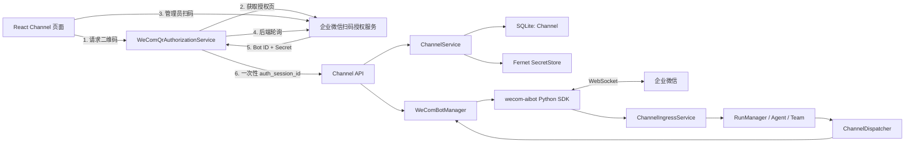

# 阶段 7.1：企业微信智能机器人扫码授权与 WebSocket 长连接

## 1. 本次升级解决什么问题

阶段 7 的企业微信“自建应用回调”是标准、稳定的接入方式，但第一次配置需要理解 CorpID、AgentId、应用 Secret、回调 Token、EncodingAESKey、公网 HTTPS 和回调 URL。它适合学习签名、加密回调与主动消息 API，却不适合做低门槛的演示入口。

阶段 7.1 参考 QwenPaw 的交互，新增企业微信“智能机器人 API 模式”：管理员扫码确认后，PawTeam Lite 获得 Bot ID 与 Secret，通过 `WecomTeam` 提供的 Python SDK 建立 WebSocket 长连接。这个模式不要求公网域名、不要求配置 HTTP 回调，也不需要用户理解五项应用参数。

本阶段保留两套 Adapter：

- `wecom_bot`：智能机器人扫码或手工凭据，WebSocket 长连接，默认推荐；
- `wecom`：阶段 7 的自建应用，HTTPS 加密回调，作为高级兼容模式。

本阶段版本为 `0.8.1`，Git 分支是 `codex/stage-7.1-wecom-bot-qr`。数据库仍是 `0008 (head)`，因为阶段 7 的通用 Channel 表已经能容纳新的 Adapter，不需要为了新增类型修改表结构。

## 2. 你需要先区分的两个企业微信概念

### 2.1 自建应用回调模式

这是阶段 7 已实现的模式：

```text
企业微信服务器
  → 公网 HTTPS POST 加密 XML
  → PawTeam Lite 验签、解密、创建 Run
  → PawTeam Lite 用 CorpID + Secret 换 access_token
  → 调 message/send 主动回复成员
```

它对应数据库中的 `Channel.kind = wecom`。企业微信是 HTTP 客户端，PawTeam Lite 必须能被公网访问。

### 2.2 智能机器人 API 模式

这是阶段 7.1 新增的模式：

```text
PawTeam Lite
  → 带 Bot ID + Secret 主动连接 wss://openws.work.weixin.qq.com
  → 在同一条 WebSocket 上接收企业微信消息
  → 创建内部 Chat 与 AgentRun
  → 在同一条 WebSocket 上主动发送 Markdown 回复
```

它对应 `Channel.kind = wecom_bot`。连接由 PawTeam Lite 主动发起，因此企业微信不需要访问你的电脑，也不需要公网 HTTPS。

“扫码授权”只负责取得连接凭据；真正长期收发消息的是 WebSocket。不要把二维码误认为消息通道。

## 3. 整体业务架构



这张图的关键不是组件数量，而是三条边界：

1. 二维码与扫码轮询属于“凭据发放”；
2. SDK 与 Manager 属于“连接生命周期”；
3. `ChannelIngressService → RunManager → ChannelDispatcher` 属于通用 Agent 消息内核。

企业微信换成别的终端时，第三段原则上不用重写。

## 4. 扫码授权的完整代码流程

### 4.1 前端发起

页面 `frontend/src/pages/ChannelsPage.tsx` 先要求选择：

- Channel 名称；
- 绑定的 Agent。

点击“扫码授权并创建”后调用：

```text
POST /api/channels/wecom-bot/qrcode
```

后端返回：

```json
{
  "auth_session_id": "一次性随机标识",
  "qrcode_image": "data:image/png;base64,...",
  "expires_in": 300
}
```

浏览器只拿到二维码图片和 PawTeam Lite 自己生成的会话 ID。

### 4.2 后端取得企业微信授权页

`backend/src/pawteam_api/channels/wecom_qr.py` 的 `start()`：

1. 请求企业微信的二维码生成页；
2. 从页面的 `window.settings` 读取 `scode` 和 `auth_url`；
3. 用 `segno` 将 `auth_url` 生成 PNG Data URL；
4. 生成不可预测的本地 `auth_session_id`；
5. 只在后端内存中保存 `auth_session_id → scode + 过期时间`。

`scode` 没有返回给浏览器，减少了前端对第三方授权协议细节的依赖。

### 4.3 轮询扫码状态

二维码弹窗每三秒调用：

```text
GET /api/channels/wecom-bot/qrcode/{auth_session_id}
```

后端用保存的 `scode` 查询企业微信。状态有：

- `waiting`：等待扫码或确认；
- `ready`：已拿到 Bot ID 与 Secret；
- `expired`：本地会话超过五分钟；
- `failed`：取消、失败或返回内容不完整。

企业微信返回成功时，Bot ID 与 Secret 被放进后端内存里的扫码会话。轮询响应仍然只返回 `ready`，不会把凭据发给 React。

### 4.4 消费一次性授权结果

前端看到 `ready` 后调用：

```text
POST /api/channels/wecom-bot
{
  "name": "团队智能助理",
  "agent_id": "...",
  "auth_session_id": "..."
}
```

路由调用 `consume(auth_session_id)` 取出凭据并立刻删除扫码会话。同一个授权结果不能再次创建 Channel。

这和 QwenPaw 截图中的“自动填入 Bot ID 与 Secret”有一个安全差异：PawTeam Lite 不把 Secret 返回浏览器或放入表单状态。使用体验仍是扫码后自动创建，但 Secret 的暴露面更小。

## 5. 凭据到底存在哪里

`ChannelService.create_bot()` 将数据拆成两部分：

```text
SQLite channels.config_json
  → {"bot_id": "..."}

data/secrets/channel_<channel-id>.secret
  → Fernet 加密后的 {"secret": "..."}
```

API 只返回掩码后的 `bot_id_masked` 和 `has_secrets=true`，永远不返回 Secret。二维码授权会话在进程内存中，成功消费、过期或服务重启后消失。

这是一条值得写入简历的设计：标识性配置、持久化密钥、短期授权状态使用不同存储边界。

## 6. 为什么没有新增 Alembic 迁移

阶段 7 的 `channels` 表已经包含：

- `kind`：区分 Adapter；
- `config_json`：保存不同 Adapter 的非敏感配置；
- `secret_ref`：指向统一密钥库；
- `agent_id/status/version`：通用绑定、生命周期与乐观锁。

因此新增 `wecom_bot` 只是新业务值：

```text
kind = wecom
config_json = {corp_id, wecom_agent_id}
secret = {token, encoding_aes_key, corp_secret}

kind = wecom_bot
config_json = {bot_id}
secret = {secret}
```

如果现在专门给 Bot ID 增加一列，未来飞书、钉钉又要继续加列，会把通用 Channel 表变成各平台字段的集合。当前设计更适合小型多渠道 Agent 项目。

## 7. WebSocket 连接如何工作

### 7.1 WeComBotConnection

`backend/src/pawteam_api/channels/wecom_bot.py` 的 `WeComBotConnection` 封装 SDK 的 `WSClient`。

每个启用的智能机器人 Channel 对应一个连接对象，并在独立线程和独立 asyncio event loop 中运行。这样做是因为 FastAPI 已有自己的主事件循环，而 SDK 需要长期维护连接、心跳和重连；两者分开可避免 SDK 的连接生命周期阻塞 API。

连接状态依次可能是：

```text
stopped → connecting → connected
                    ↘ error
connected → connecting  断线重连
```

页面的“已连接 / 连接中 / 连接异常 / 未连接”来自运行时 Manager，不是数据库字段。因此服务重启后数据库不用更新瞬态连接状态。

### 7.2 跨线程消息桥

SDK 在线程中收到消息，回调不能直接操作 FastAPI 主循环绑定的异步数据库对象。连接用：

```python
asyncio.run_coroutine_threadsafe(coroutine, fastapi_main_loop)
```

把入站处理安全地投递回主循环。数据库、RunManager 和 Dispatcher 都继续在 FastAPI 主循环中工作。

发送方向相反：Dispatcher 在 FastAPI 主循环中调用 Manager；Connection 再把 `client.send_message()` 提交给 SDK 线程的 event loop，并等待发送回执。

### 7.3 WeComBotManager

Manager 是所有机器人连接的注册表：

```text
channel_id → WeComBotConnection
```

它负责：

- 应用启动时查询所有 `kind=wecom_bot,status=active` 的 Channel 并恢复连接；
- 新建或重新授权后启动连接；
- 停用或删除 Channel 时断开连接；
- Secret 更新后先停旧连接，再用新凭据重连；
- 向页面提供连接状态；
- 把 SDK 消息转换成通用入站参数。

SDK 自身负责心跳和指数退避重连；配置 `channel_wecom_reconnect_attempts=-1` 表示持续重连。

## 8. 一条真实消息怎样进入 Agent

SDK 的文本帧包含 `body.msgtype`、`body.from.userid`、`body.chatid`、`body.msgid` 和 `body.text.content`。Manager 规范化为：

```text
external_conversation_id = chatid（没有时退回 userid）
external_user_id         = from.userid
external_message_id      = msgid
content                  = text.content
```

随后复用阶段 7 的 `ChannelIngressService.receive_text()`：

1. 用 Channel + msgid 幂等查重；
2. 用 Channel + chatid 查找或创建 `ExternalConversation`；
3. 创建或复用内部 `ChatSession(channel=wecom)`；
4. 创建 user Message、AgentRun 与 inbound ChannelMessage；
5. `RunManager.start(run_id)` 开始模型执行。

绑定普通 Agent 时直接运行；绑定 Team 的协调 Agent 时，阶段 6 的 `delegate_to_agent` 仍会按原规则注入。企业微信 Adapter 不知道也不需要知道 Team 的内部成员。

## 9. Agent 回复如何回到企业微信

Run 完成后仍由阶段 7 的代码创建 outbound ChannelMessage。`ChannelDispatcher` 根据 `Channel.kind` 选择发送器：

```text
wecom
  → 读取 CorpID + 应用 Secret
  → access_token
  → HTTP message/send

wecom_bot
  → 取得该 channel_id 的活动 WebSocket Connection
  → send_message(chatid, markdown)
```

两种 Adapter 共用认领、重试、UTF-8 安全分片、状态更新、重启恢复和人工重试逻辑。不同的只是最后一跳。

为什么保存 `chatid` 而不是只保存 UserID：单聊可用 UserID，群聊主动发送必须使用群聊 `chatid`。把它作为 `external_conversation_id` 同时解决了会话映射和回复寻址。

## 10. API 一览

| 方法与路径 | 用途 | 是否返回 Secret |
| --- | --- | --- |
| `POST /api/channels/wecom-bot/qrcode` | 开始扫码会话 | 否 |
| `GET /api/channels/wecom-bot/qrcode/{id}` | 轮询授权状态 | 否 |
| `POST /api/channels/wecom-bot` | 用扫码会话或手工凭据创建 | 否 |
| `PUT /api/channels/wecom-bot/{id}` | 修改名称与绑定 Agent | 否 |
| `PUT /api/channels/wecom-bot/{id}/credentials` | 重新扫码或手工轮换凭据 | 否 |
| `PUT /api/channels/{id}/status` | 启停并连接/断开 | 否 |
| `GET /api/channels/{id}/messages` | 查看收发与投递审计 | 否 |

手工模式与扫码模式最终进入同一个 `create_bot()`，区别只是凭据来源：

```json
{"auth_session_id": "..."}
```

或：

```json
{"bot_id": "...", "secret": "..."}
```

Pydantic 校验要求二选一，不允许同时提交或只提交半组手工凭据。

## 11. 失败场景如何理解

### 二维码获取失败

扫码入口依赖企业微信当前授权页面及查询接口。它们不是 SDK 内的稳定 API，页面格式变化时可能出现“二维码页面格式已变化”。此时手工 Bot ID / Secret 仍能工作，不影响 WebSocket 主链路。

### 一直显示等待扫码

可能是尚未在手机端确认、二维码过期，或当前账号没有创建机器人的权限。关闭弹窗重新获取。二维码会话只存在当前后端进程，重启后必须重新扫码。

### 创建后一直“连接中”

说明 Channel 与密钥已保存，但 WebSocket 尚未认证成功。检查网络是否能访问 `openws.work.weixin.qq.com`，以及 Bot ID / Secret 是否匹配。重新授权会替换密钥并重连。

### 显示“连接异常”

SDK 报告了认证或网络错误。当前页面展示聚合状态，详细异常看 Backend API 控制台。后续阶段可以把连接错误和最后心跳时间持久化成运维事件。

### 收到消息但没有回复

按顺序检查：

1. Channel 消息日志是否有 inbound；
2. Agent 控制台是否创建 Run；
3. Run 是否失败或 Provider 配置错误；
4. outbound 是 `pending/retrying/failed` 还是 `delivered`；
5. 后端控制台是否有 WebSocket 发送错误。

不要一开始就把问题归因于企业微信。日志在哪一层停止，问题就在哪一层附近。

## 12. PyCharm 中由你手工执行

### 12.1 切换分支并安装依赖

本阶段已经在分支 `codex/stage-7.1-wecom-bot-qr`。你在 PyCharm Terminal 中执行：

```bash
git branch --show-current
uv sync
npm --prefix frontend install
uv run alembic upgrade head
uv run alembic current
```

预期：

```text
codex/stage-7.1-wecom-bot-qr
0008 (head)
```

没有 `0009` 是正常结果，不代表漏迁移。

### 12.2 启动项目

由你在 PyCharm 手动运行原来的两个配置：

1. `Backend API`；
2. `Frontend Dev`。

打开 `http://127.0.0.1:5173`，页面顶部应是 `STAGE 7.1`。

### 12.3 走一遍扫码流程

1. 先确认“Provider 与模型”中模型测试成功；
2. 确认已有一个启用的 Agent；
3. 打开“企业微信 Channel”；
4. 在“扫码授权”页签填写 Channel 名称并选择 Agent；
5. 点击“扫码授权并创建”；
6. 用企业微信扫码并在手机端确认；
7. 等弹窗自动关闭；
8. Channel 卡片应显示“智能机器人”和“已连接”；
9. 在企业微信中找到刚创建的机器人并发送文本；
10. 查看 Channel 消息日志与 Agent 控制台；
11. 等待机器人回复。

扫码时如果企业微信询问额外能力授权，第一次测试先选择“暂不授权”。这可减少机器人只有创建者可用等权限差异带来的干扰。确认基础收发后，再单独研究企业微信能力授权范围。

### 12.4 先不扫码也能验证内部链路

你可以创建 Channel 后用“模拟入站”验证 `Channel → Chat → Run → outbound`。但智能机器人 outbound 会真实尝试通过 WebSocket 发送，因此要看到 `delivered`，连接必须已认证。

## 13. 自动化验证覆盖了什么

`backend/tests/test_channels.py` 新增了一条智能机器人闭环测试：

1. 模拟二维码开始与授权完成；
2. 确认开始、轮询和创建响应都不泄露 Secret；
3. 确认密钥文件中没有明文 Secret；
4. 模拟 SDK 从群聊收到文本帧；
5. 确认创建 inbound、Chat、Run 和 outbound；
6. 确认 Agent 回复使用原 `chatid` 发回；
7. 停用 Channel 后确认连接关闭。

真实的二维码生成端点也在开发环境做过连通验证：能够解析当前企业微信页面并生成 PNG Data URL。自动化测试不依赖公网，以免第三方网络波动让本地测试不稳定。

本阶段验收命令：

```bash
uv run ruff check backend/src/pawteam_api backend/tests
uv run pytest -q
npm --prefix frontend run build
```

## 14. 这一阶段你要完全掌握什么

至少能不用看代码回答下面十个问题：

1. 扫码授权和 WebSocket 消息通道为什么不是一回事？
2. `wecom` 与 `wecom_bot` 两个 Adapter 的网络方向有什么不同？
3. 为什么智能机器人不需要公网 HTTPS？
4. 为什么浏览器只拿 `auth_session_id`，不拿 Secret？
5. Bot ID、Secret、扫码临时状态分别存在哪里？
6. 为什么新增 Channel 类型不需要数据库迁移？
7. 为什么 SDK 使用独立线程和 event loop？
8. 入站回调怎样安全回到 FastAPI 主循环？
9. 为什么 `chatid` 既是外部会话键，也是回复地址？
10. Dispatcher 如何在不复制业务流程的情况下支持两种企业微信模式？

如果你能把这十点按“授权、存储、连接、入站、运行、出站、恢复”七个词串成一条链路，这一阶段就真正掌握了。

## 15. 简历可如何描述

可以写成：

> 设计并实现多 Adapter 企业微信 Channel：支持扫码获取智能机器人凭据与 SDK WebSocket 长连接，同时兼容自建应用 AES 回调；以服务端一次性授权会话避免 Secret 经浏览器传输，复用统一的外部会话映射、Agent Run、幂等消息、持久化 Outbox 与重试审计链路，并实现连接启动恢复与运行时状态展示。

面试时不要只说“接了企业微信”。重点讲清楚为什么扫码结果不回浏览器、为什么连接状态不进数据库、为什么通用 Channel 表无需迁移、以及如何在两个 asyncio event loop 之间传递消息。

## 16. 参考实现与协议资料

- [QwenPaw 项目](https://github.com/agentscope-ai/QwenPaw)：本阶段扫码交互与 Channel 可扩展性的参考来源；
- [QwenPaw 二维码授权处理器](https://github.com/agentscope-ai/QwenPaw/blob/main/src/qwenpaw/app/channels/qrcode_auth_handler.py)：用于核对二维码生成页与轮询流程；
- [企业微信智能机器人 Python SDK](https://github.com/WecomTeam/wecom-aibot-python-sdk)：用于 WebSocket 认证、心跳、断线重连、消息事件与主动发送。

扫码页面接口目前不属于 Python SDK 的稳定公共接口，所以本项目明确保留手工凭据入口；WebSocket 主链路使用 SDK 的公开能力。将“便捷授权”与“稳定消息通道”分开，是这里的重要工程取舍。
