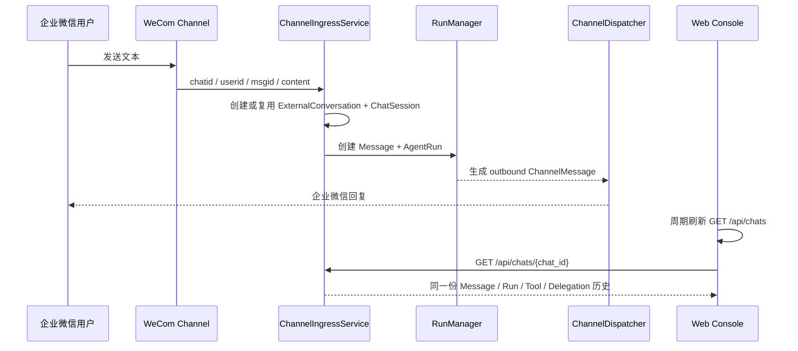

# 阶段 7.2：跨 Channel 统一会话控制台

## 1. 本阶段解决的问题

企业微信接入后，如果只能在 Channel 页看到两条收发日志，而不能在 Agent 控制台打开完整对话，那么 Chat、Run、Tool 和 Team 审计仍然是割裂的。

阶段 7.2 将网页和企业微信明确统一到一个会话内核：

- 网页新建的会话：`ChatSession.channel = console`；
- 企业微信首次发消息创建的会话：`ChatSession.channel = wecom`；
- 两者都使用同一张 `chat_sessions`、`messages`、`runs` 表；
- Agent 控制台默认查询全部 Agent、全部 Channel；
- 企业微信会话可以查看完整历史与执行审计，但不能在网页伪造外部用户输入。

本阶段版本为 `0.8.2`，Git 分支是 `codex/stage-7.2-unified-channel-chat`。数据库版本仍是 `0008 (head)`，因为本次只扩展查询与 API 返回字段，没有新增持久化字段。

## 2. 先理解：不是复制聊天记录

错误做法是企业微信维护一份消息，网页再复制一份。这样会产生同步延迟、重复数据和两个互相冲突的历史版本。

PawTeam Lite 的设计是：

```text
网页 Console ───────────────┐
                           ├─→ ChatSession → Message → AgentRun
企业微信 Channel → 映射层 ─┘
```

企业微信的 `ChannelMessage` 只负责渠道边界审计；模型实际看到的对话仍写入统一 `Message`。网页现在展示的就是这份唯一历史，而不是重新从 ChannelMessage 拼一份聊天。

### 两类消息表仍不能合并

`Message` 关心：

- user / assistant；
- Prompt 中的顺序；
- final / partial；
- 属于哪个 Run。

`ChannelMessage` 关心：

- inbound / outbound；
- 外部 msgid；
- 投递状态与重试次数；
- 发送错误和 delivered_at。

统一控制台展示 `Message`，Channel 页展示 `ChannelMessage`。它们通过 `chat_session_id` 和 `run_id` 相互追踪。

## 3. 外部会话怎样找到内部 Chat

阶段 7 已经建立 `ExternalConversation`：

```text
Channel
  id
  name
  kind
       ↓ channel_id
ExternalConversation
  external_conversation_id
  external_user_id
  chat_session_id
       ↓
ChatSession
```

阶段 7.2 没有改变这条关系，只是在 `ChatService.list()` 和 `ChatService.get()` 中做外连接，把来源元数据一起返回。

API 的 `ChatSessionResponse` 新增：

| 字段 | 含义 | 网页会话 |
| --- | --- | --- |
| `channel_id` | 外部 Channel ID | `null` |
| `channel_name` | 页面可读的 Channel 名称 | `null` |
| `channel_kind` | `wecom` 或 `wecom_bot` | `null` |
| `external_conversation_id` | 单聊用户或群聊 chatid | `null` |
| `external_user_id` | 最近发消息的企业微信 UserID | `null` |

这些字段都是已有表的查询结果，不是把相同数据再保存进 ChatSession，所以不需要 Alembic 迁移。

## 4. 为什么使用 outer join

查询链路是：

```text
ChatSession
  JOIN Agent
  LEFT JOIN ExternalConversation
  LEFT JOIN Channel
```

Agent 使用普通 `JOIN`，因为每个 Chat 必须绑定有效 Agent。来源表使用 `LEFT JOIN`，因为网页会话本来就没有 ExternalConversation。

如果使用普通 JOIN，所有 console 会话都会从结果中消失；如果分别查询再在 Python 循环中读取来源，会形成 N+1 查询。一次 outer join 同时覆盖两种会话。

## 5. 网页控制台的变化

### 5.1 默认查看全部入口

过去页面启动时自动选中第一个 Agent。企业微信 Channel 如果绑定了另一个 Agent，会话虽然已在数据库，却像是“看不到”。

现在默认范围是：

```text
全部 Agent / 全部 Channel
```

也可以选择某个 Agent 过滤。只有选中具体 Agent 后才能创建网页会话，因为创建 Chat 必须知道绑定谁。

### 5.2 来源标签

列表使用两种标签：

- `网页`：用户从 PawTeam Lite 控制台发起；
- `企业微信`：由自建应用或智能机器人创建。

外部会话副标题显示 Agent、Channel 名称和更新时间。详情标题继续显示 Channel 名称、接入模式和外部 UserID。

用户消息的说话人也不再统一显示“你”：

- console 会话显示“你”；
- wecom 会话显示真实的 `external_user_id`；
- assistant 始终显示 Agent 名称。

### 5.3 自动发现新会话

企业微信可能在网页打开之后才收到第一条消息。页面每四秒刷新一次会话摘要：

1. 新外部 Chat 自动出现在列表顶部；
2. 选中的外部 Chat 如果 `updated_at` 变化，重新读取详情；
3. 如果发现活动 Run，连接现有 SSE；
4. Run 结束后继续展示持久化结果。

轮询只读取轻量会话列表，不持续拉取每个 Chat 的全部消息。只有当前外部 Chat 发生变化时才重新读取详情。

## 6. 为什么外部会话在网页中只读

如果网页对企业微信 Chat 仍显示普通输入框，点击发送会出现语义问题：

- 这条 user Message 并不是企业微信用户发的；
- Run 完成后 Dispatcher 又会把回答发回企业微信；
- 审计记录看起来像外部用户主动提问，实际是网页操作者伪造；
- 群聊场景更无法说明网页操作者代表谁。

因此本阶段采用明确边界：

```text
console Chat
  → 网页可读、可写

wecom Chat
  → 网页可读、不可写
  → 可查看 Run / Tool / Delegation
  → 活动 Run 仍可由管理员停止
  → 新消息回到企业微信发送
```

这个限制不只在 React 隐藏输入框。`RunCommandService.create()` 也检查 `chat.channel`，直接调用 `POST /api/chats/{id}/runs` 伪造消息会返回 HTTP 409。

前后端都做限制的原因是：UI 是体验边界，API 才是安全边界。

未来如果实现“人工客服接管”，应该新增明确的 operator 消息角色、操作者身份和 Channel 主动发送记录，而不是复用 user Message 假装企业微信用户。

## 7. 一条企业微信记录怎样呈现在网页



网页刷新不是企业微信消息进入系统的必要步骤。即使网页关闭，Channel、Run 与回复都正常工作；网页只是这份持久化状态的观察入口。

## 8. 你现在可以看到什么

选择企业微信会话后，页面依次展示：

1. 会话标题；
2. 绑定 Agent；
3. Channel 名称与接入模式；
4. 外部 UserID；
5. 全部 user / assistant Message；
6. 当前活动 Run 的 SSE 状态；
7. 最近 Run 状态、模型与耗时；
8. Tool 调用参数、结果或错误；
9. Team 委派的来源、目标、任务、状态和深度。

Channel 页的“消息日志”仍保留，用于检查企业微信收发与投递；Agent 控制台用于理解模型真正经历的完整对话和执行过程。

## 9. SOCKS 代理依赖修复

本阶段同时保留了你手工执行 `uv add` 产生的依赖更新：

```toml
python-socks[asyncio]>=2.7,<3
```

macOS 系统配置 SOCKS 代理时，`websockets` 会自动选择它。缺少 `python-socks` 时，二维码凭据虽然保存成功，但 WebSocket 无法建立，消息自然不会进入统一会话。依赖现在进入 `pyproject.toml` 和 `uv.lock`，其他环境执行 `uv sync` 也能复现正确安装。

## 10. PyCharm 中由你手工执行

在 PyCharm Terminal 中：

```bash
git branch --show-current
uv sync
uv run alembic upgrade head
uv run alembic current
npm --prefix frontend install
```

预期：

```text
codex/stage-7.2-unified-channel-chat
0008 (head)
```

然后由你重启：

1. `Backend API`；
2. `Frontend Dev`。

浏览器打开 `http://127.0.0.1:5173`：

1. 进入“Agent 控制台”；
2. 会话范围保持“全部 Agent / 全部 Channel”；
3. 找到带橙色“企业微信”标签的会话；
4. 打开后检查 Channel、外部用户和历史；
5. 确认页面显示只读提示而不是输入框；
6. 从企业微信再发一条消息；
7. 最多等待约四秒，网页列表和详情应自动更新。

## 11. 自动化与真实页面验证

后端测试覆盖：

- console Chat 的来源字段全部为空；
- 自建应用 Chat 返回 Channel 和外部用户元数据；
- 智能机器人群聊返回原 `chatid` 与 UserID；
- Chat Detail 包含企业微信问答的完整 Message；
- 尝试从网页 API 向外部 Chat 创建 Run 会被 409 拒绝。

本阶段还在真实本地数据库和页面上验证：企业微信会话能出现在统一列表、打开完整历史、展示智能机器人来源、外部用户、Run、Tool 与 Team 委派，并显示只读提示。

验证命令：

```bash
uv run ruff check backend/src/pawteam_api backend/tests
uv run pytest -q
npm --prefix frontend run check
npm --prefix frontend run build
```

## 12. 这一阶段要掌握的内容

你应该能够回答：

1. 为什么企业微信记录不是复制到网页，而是共享 ChatSession？
2. Message 和 ChannelMessage 各自审计什么？
3. ExternalConversation 如何把 chatid 映射到内部 Chat？
4. 为什么来源信息通过 outer join 查询？
5. 为什么 console 来源字段应该是 null？
6. 为什么默认查看全部 Agent 才不会“隐藏”外部会话？
7. 页面怎样发现运行期间新建的 Channel Chat？
8. 为什么企业微信 Chat 在网页只读？
9. 为什么只隐藏输入框还不够，后端也必须拒绝？
10. Channel 页消息日志和 Agent 控制台分别解决什么问题？

## 13. 简历表达

> 设计跨 Channel 统一会话模型，将 Web Console 与企业微信消息映射到同一 Chat/Message/Run 内核；通过 ExternalConversation 维护外部 chatid 与内部会话的一致映射，以 outer join 提供 Channel 来源元数据，并实现外部会话实时发现、完整执行审计及前后端双层只读权限边界，避免控制台伪造外部用户消息。
