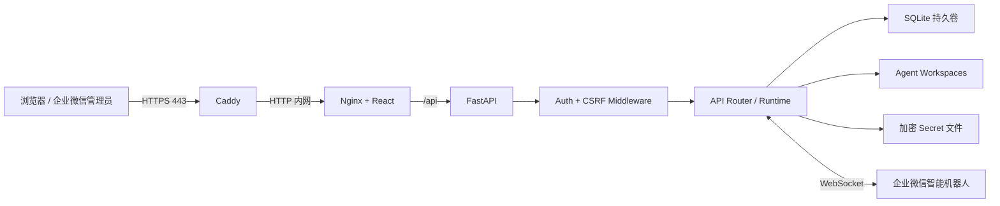
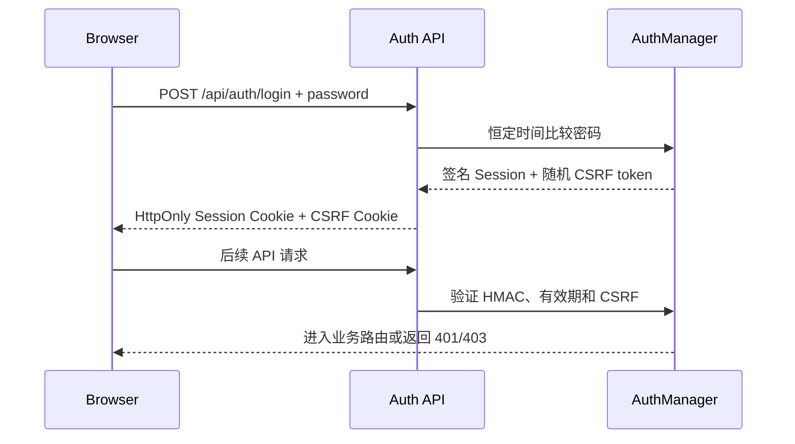

# 阶段 8：生产安全与单机上线

## 1. 本阶段的完成标准

阶段 8 把“能在开发机运行”收口为“能在一台云服务器长期运行”。版本从 `0.8.2` 升为 `1.0.0`，Git 分支是 `codex/stage-8-production`，数据库仍为 `0008 (head)`。

完成后适用范围是：

- 一名管理员；
- 一台 Linux 云服务器；
- 一个域名；
- 一个后端进程；
- SQLite 持久卷；
- 网页控制台与企业微信 Channel；
- 个人项目展示、作品集或小团队自托管。

这不是多租户 SaaS。当前没有用户注册、角色权限、租户隔离、PostgreSQL、高可用或多副本调度。简历里应称为“可生产部署的单管理员自托管 Agent 平台”，不要写成商业级 SaaS。

## 2. 从浏览器到数据库的完整链路



每一层职责不同：

| 层 | 负责什么 | 不负责什么 |
| --- | --- | --- |
| Caddy | 域名、TLS 证书、HTTP 转 HTTPS、外网入口 | Agent 业务 |
| Nginx | 静态 React 文件、同源 `/api` 代理、安全响应头、SSE 透传 | 登录判断 |
| Auth Middleware | Session、CSRF、公开路径边界 | Provider/Agent 业务 |
| FastAPI Router | 参数校验、业务编排、状态码 | 浏览器页面 |
| Service/Runtime | Provider、Agent、Tool、Team、Channel 规则 | TLS |
| SQLite/Workspace/Secrets | 持久化三种不同类型的数据 | 对外服务 |

外网只开放 Caddy 的 80/443。Frontend 和 Backend 只有 Compose 内部网络地址，没有主机端口，因此无法绕过 HTTPS 和 Nginx 直接访问管理 API。

## 3. 为什么必须增加登录

阶段 7.2 的网页可以直接管理：

- Provider API Key；
- Agent 的 SOUL、PROFILE、Skill 和 Tool 权限；
- Team 与 Channel；
- 企业微信 Bot Secret；
- 全部聊天、Tool 和委派审计。

如果直接把开发版端口暴露到公网，任何访问者都能控制这些资源。阶段 8 使用单管理员模式，密码只来自环境变量，不进入数据库。

### 3.1 登录业务流



Session 载荷包含管理员身份、过期时间、随机 nonce 和 CSRF token，并由 `PAWTEAM_AUTH_SECRET_KEY` 进行 HMAC-SHA256 签名。签名能防篡改，但载荷不是用来保存秘密的。

Session Cookie 使用：

- `HttpOnly`：前端 JavaScript 读不到会话；
- `Secure`：生产环境只通过 HTTPS 发送；
- `SameSite=Strict`：跨站请求默认不携带；
- 12 小时有效期，可由 `PAWTEAM_AUTH_SESSION_HOURS` 调整。

登录失败按来源进行内存限速。它适合当前单进程边界；多副本系统应改用 Redis 等共享限速器。

## 4. CSRF 为什么和登录不是一回事

Cookie 会被浏览器自动携带。只有登录判断时，恶意网站可能诱导已登录浏览器向 PawTeam 发送写请求，这就是 CSRF 风险。

因此所有 `POST / PUT / PATCH / DELETE` 需要同时满足：

1. HttpOnly Session Cookie 签名有效；
2. 可读 CSRF Cookie 存在；
3. 前端把同一值放进 `X-CSRF-Token` Header；
4. Header、Cookie、Session 中的 token 三者恒定时间比较一致。

`frontend/src/api/http.ts` 是唯一请求出口，自动完成这件事。各业务 API 文件只描述 URL、方法和数据类型，不再重复实现鉴权。

企业微信传统回调是公开路径，因为企业微信服务器不可能先登录网页。它不等于无保护：回调继续验证时间窗口、微信签名、AES 密文和 Channel 配置。

## 5. 开发与生产配置边界

开发环境默认不设置 `PAWTEAM_ADMIN_PASSWORD`，登录功能关闭，原有 PyCharm 调试流程不受影响。若本地也想体验登录，在 `.env` 同时设置：

```dotenv
PAWTEAM_ADMIN_PASSWORD=你自己的长密码
PAWTEAM_AUTH_SECRET_KEY=至少32位随机字符串
```

生产环境执行 `Settings.validate_runtime()`，缺少以下任一项就直接拒绝启动：

- `PAWTEAM_ADMIN_PASSWORD`：至少 12 个字符；
- `PAWTEAM_AUTH_SECRET_KEY`：至少 32 个字符；
- `PAWTEAM_SECRET_KEY`：合法 Fernet Key，用于加密 Provider/Channel Secret；
- `PAWTEAM_ALLOWED_HOSTS`：不能使用 `*`。

这叫 fail closed：错误配置的结果是服务不上线，而不是无密码上线。

生产环境还会关闭 `/docs`、`/redoc` 和 `/openapi.json`，并通过 TrustedHost 拒绝非配置域名的 Host Header。

## 6. 健康检查

三个端点含义不同：

| API | 用途 | 数据库故障时 |
| --- | --- | --- |
| `GET /api/health/live` | 进程是否能响应 HTTP | 仍返回 204 |
| `GET /api/health/ready` | 是否可以接业务流量 | 返回 503 |
| `GET /api/health` | 控制台展示版本、环境和 DB 状态 | 返回 degraded 信息 |

Docker 使用 readiness，而不是只检查端口。Frontend 等 Backend 健康后启动，Caddy 再等 Frontend 健康，形成确定的启动顺序。

## 7. HTTPS 与安全响应头

Caddy 从 `PAWTEAM_DOMAIN` 读取域名，自动申请和续期 TLS 证书，并把 HTTP 重定向到 HTTPS。Caddy 的 `/data` 和 `/config` 使用持久卷，证书状态不会随容器重建丢失。

Nginx 增加：

- `Content-Security-Policy`；
- `X-Content-Type-Options: nosniff`；
- `X-Frame-Options: DENY`；
- `Referrer-Policy`；
- `Permissions-Policy`；
- SSE 关闭代理缓冲并延长读取超时；
- 带哈希的前端 assets 一年浏览器缓存。

Caddy 增加 HSTS。第一次证书申请前必须满足：域名 A/AAAA 已指向服务器，公网 80/443 可达，Caddy 数据目录可写且持久化。

## 8. 备份到底备份什么

`python -m pawteam_api.backup create` 不会粗暴复制正在写入的 SQLite 文件，而是调用 SQLite Online Backup API 生成一致快照，然后归档：

```text
pawteam-backup/
  manifest.json
  app.db
  workspaces/
  secrets/
```

其中：

- `app.db`：Agent、Provider 元数据、Chat、Run、Team、Channel 与审计；
- `workspaces/`：核心 Markdown 和 Skills；
- `secrets/`：加密后的 Provider/Channel Secret；
- `manifest.json`：格式、版本和创建时间。

`PAWTEAM_SECRET_KEY` 故意不写进归档。归档和解密钥匙放在一起会失去加密意义。你必须把这个 Key 单独保存在密码管理器或云厂商 Secret Manager 中；丢失后，即使数据库和 Secret 文件都在，也无法解密 API Key 和企业微信凭据。

恢复命令必须带 `--force`，且会先自动创建 `pre-restore-*.tar.gz` 安全副本。恢复只能在服务停止时执行，避免旧进程继续向被替换的数据写入。

## 9. CI 负责什么

`.github/workflows/ci.yml` 在 push 到 main 或 Pull Request 时执行：

1. 使用锁文件安装 Python 依赖；
2. 使用 `npm ci` 安装前端依赖；
3. Ruff 检查；
4. 全部 Pytest；
5. TypeScript 检查和 Vite 生产构建；
6. 校验本地 Docker Compose 语法。

CI 是“代码是否具备发布条件”的自动门禁，不会持有服务器密码，也不会自动上线。当前项目更适合你先手工部署并真正理解每一步；以后再单独加入 CD。

## 10. 在 PyCharm 中由你手工验收

先在 PyCharm Terminal 执行：

```bash
git branch --show-current
uv sync
uv run alembic upgrade head
uv run alembic current
npm --prefix frontend install
make check
make test
make build
docker compose config --quiet
```

预期分支是 `codex/stage-8-production`，数据库是 `0008 (head)`。

### 本地体验登录

在 `.env` 追加：

```dotenv
PAWTEAM_ADMIN_PASSWORD=local-test-password-123
PAWTEAM_AUTH_SECRET_KEY=local-auth-secret-key-at-least-32-characters
```

然后由你在 PyCharm 重启 `Backend API` 和 `Frontend Dev`：

1. 打开 `http://127.0.0.1:5173`；
2. 确认先显示管理员登录页；
3. 输入错误密码，确认被拒绝；
4. 输入 `.env` 中的正确密码；
5. 进入任一页面执行一次写操作；
6. 点击右上角“退出登录”；
7. 确认返回登录页。

验收后如果希望继续无登录本地开发，删除 `.env` 中这两个配置并重启后端。

## 11. 云服务器上线步骤

### 11.1 准备服务器与域名

准备一台安装 Docker Engine 与 Docker Compose Plugin 的 Linux 服务器：

1. 域名 A 记录指向服务器 IPv4；有 AAAA 时也必须正确指向 IPv6；
2. 云安全组和系统防火墙开放 TCP 80、TCP 443、UDP 443；
3. 不要额外开放 8000、8080 或 SQLite 文件；
4. 将仓库 clone 到服务器。

### 11.2 创建生产配置

```bash
cp .env.production.example .env.production
python -c "import secrets; print(secrets.token_urlsafe(48))"
uv run python -c "from cryptography.fernet import Fernet; print(Fernet.generate_key().decode())"
chmod 600 .env.production
```

编辑 `.env.production`：填真实域名、长管理员密码、第一条命令生成的 Auth Secret、第二条命令生成的 Fernet Key。三个秘密不要提交 Git。

### 11.3 校验并启动

```bash
make prod-config
make prod-up
docker compose --env-file .env.production -f compose.production.yml ps
docker compose --env-file .env.production -f compose.production.yml logs --tail=100
```

浏览器访问 `https://你的域名`。第一次签发证书需要一些时间，可用下面命令观察：

```bash
docker compose --env-file .env.production -f compose.production.yml logs -f caddy
```

### 11.4 上线后验收

- `https://域名/api/health/live` 返回 204；
- `https://域名/api/health/ready` 返回 200；
- HTTP 自动跳转 HTTPS；
- 未登录只能访问登录/健康端点；
- 登录后旧 Provider、Agent、Team、会话与 Channel 都存在；
- 企业微信智能机器人连接状态为 connected；
- 从企业微信发消息，网页控制台能看到同一会话。

## 12. 日常备份、恢复与更新

### 创建并验证备份

```bash
mkdir -p backups
make backup
ls -lh backups
docker compose --env-file .env.production -f compose.production.yml exec backend \
  python -m pawteam_api.backup verify --archive /app/backups/备份文件.tar.gz
```

把备份复制到另一台机器或对象存储，并定期真实演练恢复。只留在同一块服务器磁盘上的文件不算完整备份。

### 离线恢复

```bash
make prod-down
docker compose --env-file .env.production -f compose.production.yml run --rm --no-deps backend \
  python -m pawteam_api.backup restore \
  --archive /app/backups/备份文件.tar.gz --force
make prod-up
```

恢复后检查 readiness、登录、Provider 解密和一条真实 Agent 对话。必须使用备份创建时对应的 `PAWTEAM_SECRET_KEY`。

### 更新版本

```bash
make backup
git pull --ff-only
make prod-config
make prod-up
```

Backend 容器启动时自动执行 `alembic upgrade head`。不要在不了解迁移影响时手工 downgrade 生产数据库。

## 13. 仍然存在的生产边界

1. SQLite 与企业微信 Bot WebSocket Manager 要求单后端副本，不能横向扩容；
2. 登录只有 admin，没有 RBAC 和操作人区分；
3. 内存登录限速重启后清零；
4. 没有 Prometheus、集中日志和告警平台；
5. 没有自动 CD，升级由管理员执行；
6. Provider 的可用性和费用仍由外部服务决定；
7. 服务器、域名、企业微信和模型平台本身的权限安全仍需你负责。

如果下一步要做商业 SaaS，应优先拆成 PostgreSQL、Redis、对象存储、任务队列、多租户 RBAC、审计身份、可观测性和独立 Channel Worker，而不是直接给当前 Compose 增加多个副本。

## 14. 这一阶段必须掌握的问题

1. 为什么开发环境可以关闭登录，而 production 必须 fail closed？
2. HttpOnly、Secure、SameSite 分别防什么？
3. 为什么有 Session 仍要 CSRF token？
4. 为什么企业微信公开回调不能套网页登录，它又靠什么保护？
5. Caddy、Nginx、FastAPI 各自处于哪一层？
6. liveness 和 readiness 为什么不能混用？
7. 为什么只开放 80/443，不能暴露 Backend 端口？
8. SQLite Online Backup 比直接 `cp app.db` 好在哪里？
9. 为什么备份包不应该包含 `PAWTEAM_SECRET_KEY`？
10. 为什么当前架构不能直接运行两个 Backend 副本？
11. CI、部署和运行时健康检查分别解决什么问题？
12. “可以上线”和“商业 SaaS”之间还差哪些能力？

## 15. 简历表达

> 独立设计并实现可生产部署的单管理员多 Agent 平台：以 HMAC 签名 HttpOnly Session、SameSite Cookie 和双提交 CSRF 建立控制台安全边界；采用 Caddy 自动 HTTPS、Nginx 同源反向代理与安全响应头完成公网入口收敛；通过 production fail-closed 配置校验、liveness/readiness、Docker 健康依赖、SQLite 一致性备份/离线恢复及 GitHub Actions CI，形成从代码验证、密钥管理、部署到灾难恢复的完整上线闭环。

## 16. 官方资料

- [Caddy Automatic HTTPS](https://caddyserver.com/docs/automatic-https)
- [Caddy HTTPS Quick Start](https://caddyserver.com/docs/quick-starts/https)
- [Docker Compose 启停顺序与 service_healthy](https://docs.docker.com/compose/how-tos/startup-order/)
- [SQLite Online Backup API](https://www.sqlite.org/backup.html)
- [actions/checkout Releases](https://github.com/actions/checkout/releases)
- [actions/setup-node Releases](https://github.com/actions/setup-node/releases)
- [astral-sh/setup-uv Releases](https://github.com/astral-sh/setup-uv/releases)
